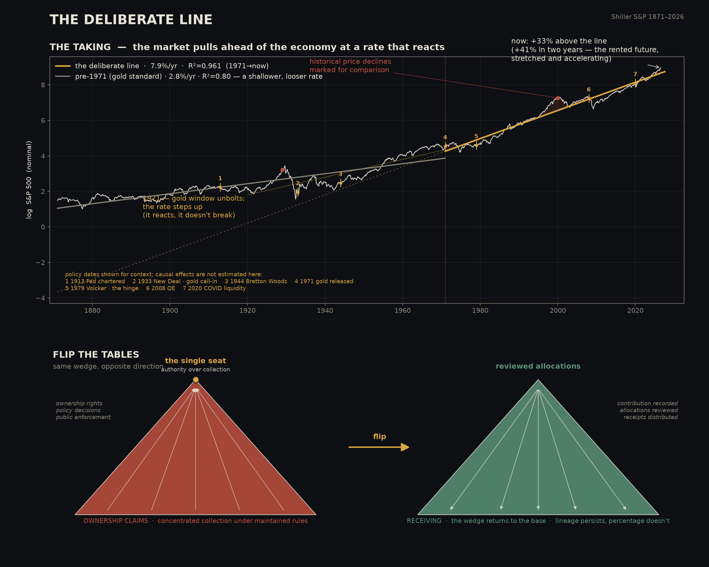
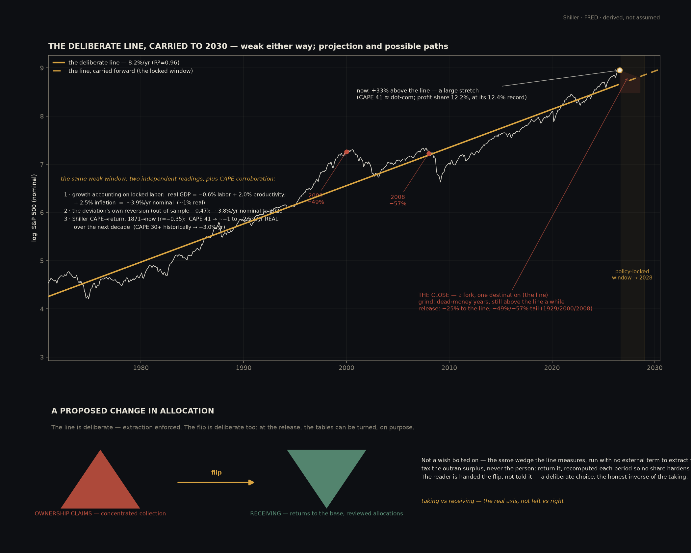
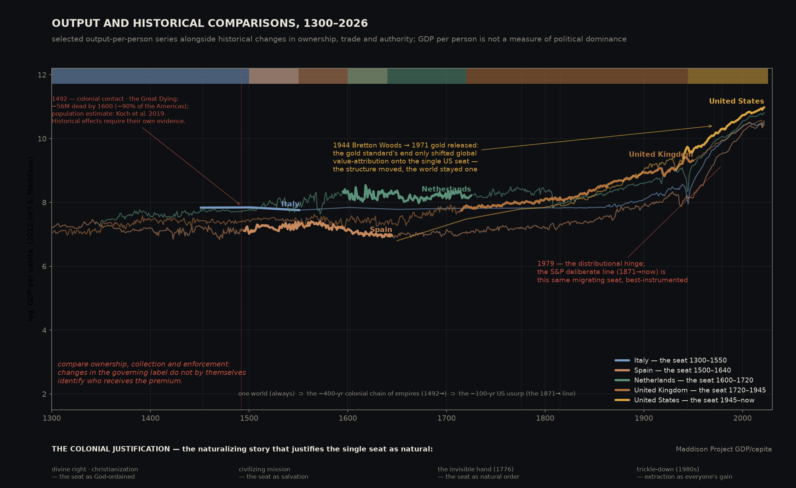

# The Deliberate Line: Taking a Goodhart
### What actually moves the market — a sourced, reproducible account, in plain terms

> *The deliberate line takes a Goodhart;*  
> *a Goodhart takes a deliberate line.*

*Public edition. Every claim below is either computed from public data (with the code to reproduce it)
or cited to a public source. The math is written in ordinary terms so every step can be checked. Not
investment advice; a description of what the record shows.*

---

*In one minute:*

Over the measured 56-year window, the S&P 500 follows a fitted log-linear trend of about **8% annual compounded price growth**. Larger deviations above that trend are associated with weaker subsequent returns in the historical comparisons. The broader expanding-fit and resampling checks do not establish a reliable price-timing advantage.

That line isn't the Federal Reserve — its levers, tested honestly, don't draw it — and it isn't just
the economy growing. Roughly **2% a year is the market outrunning the economy**: the same output priced
higher, a transfer from workers to owners that breaks across every measure at once, starting **around
1979**.

The paper connects that premium to ownership claims, policy decisions, and public enforcement. Owners, executives, and officials act within those arrangements; the premium is the financial result of the operation they sustain. The historical comparisons and proposed alternative examine how the rules of collection persist and how they could change.

This account examines a historical price trend, its relation to output, and the institutional arrangements sustaining the premium above output growth. Projections depend on the stated economic and policy assumptions. Built entirely from public data, it includes the calculations and the limits of the prediction checks.

---

## The question

The plain question: *what actually moves the stock market over the long run?* Not a forecast to
trade on; a description honest enough to hold up out of sample. What follows is what the public data
says, with the reasoning shown.

## 1. There is a single line, and it predicts

First, one plain idea that makes the rest easy. Money doesn't grow by adding the same *dollars* each
year — it grows by the same *percent*, the way a savings account, a population, or even a rumor does. When
something grows by a steady percent, there's a simple lens — the **logarithm** — that turns that curving
growth into a straight line you can eyeball. *(If that word trips you, skip it: "the market grows by a
steady percent a year" is the whole of it.)* So take the S&P 500's daily close, put it under that lens,
and fit a straight line against time:

```
log(price) ≈ a + b · t
```

The slope `b` comes out to **≈7.9% per year** in log terms, or approximately **8.2% compounded**, with **R² ≈0.962** over the measured 56-year record. R² describes the fraction of historical log-price variation accounted for by this fitted time trend. It does not identify the cause of the trend. The explanation below connects growth above output to the rules governing claims and collection; that connection requires the economic and institutional evidence as well as the fit.

Define the **deviation** — how far above or below the line price currently sits:

```
d = log(price) − (a + b · t)
```

Full-sample comparisons associate higher fitted deviations with weaker subsequent returns: the reported correlations are **−0.09, −0.15, and −0.31 at 1, 3, and 12 months**. These are historical associations. Using a line fitted to the full sample is different from forming a forecast with only information available at the time.

A fixed historical split gives a **−0.47** deviation/forward-return correlation outside the fitting window, compared with **−0.37** inside it. That split alone overstates the strength of the prediction. Expanding the fit month by month and comparing the results with resampled market increments produces correlations within the comparison bands at every tested horizon. The reported lowest- and highest-deviation groups—about **−49% and +46% in log deviation**—have forward annual returns around **+15.7% and +4.3%**. These descriptive differences do not establish a dependable timing advantage or a guaranteed bound on future losses. `predict.py` and `string_correlates.py` expose the different calculations.



*The deliberate line (gold) traced against the S&P 500 (white), 1871–2026: the market pulls ahead of the economy at a rate that steps up at each turn but never breaks — and the same wedge, flipped (red → green), is the way out.*

*(One honest caveat, and it follows from section 8: if enough people come to read this line, the reading
itself becomes a target — and by Goodhart's law, any measure everyone watches gets gamed and moves. A line
enough people price in stops sitting where it sat; publishing it is itself one more turn of the very thing
it describes. That isn't a hole in the finding — it's the finding reaching the reader.)*

**Description, projection, and explanation.** A fitted historical line describes the record. Extending it requires assumptions about continued growth and the arrangements supporting returns. The fixed-split −0.47 correlation is reported above; the expanding-fit comparisons against resampled increments do not establish a reliable timing advantage. The institutional explanation therefore has to stand on the specified mechanisms and their relation to the premium, rather than on a claim that the price tests validate themselves.

**What would challenge the account.** Relevant contrary evidence would include persistent collection of the same above-output premium without the supporting ownership and enforcement arrangements identified here; changes in those arrangements that fail to produce the predicted changes in collection; or distributional changes that are better explained by competing mechanisms. Each comparison needs an explicit population, period, and definition of the premium. A failed price forecast remains a failed forecast; it is not evidence for the institutional explanation.

**Scope.** The estimates concern the named indices and historical windows. Comparing other markets requires their own data and an account of the arrangements sustaining claims there. A prolonged loss or a market's closure cannot by itself confirm this explanation: the claimed institutional change and its financial consequences must be established separately.

## 2. The Federal Reserve isn't the line's engine *on its own* (its levers, tested alone, fail)

The obvious explanation is that the Fed draws the line — its rate lever, its money printing. Tested on
their own, those levers don't hold up.

- **Interest-rate decisions.** A simple before/after study *looks* like rate hikes push the market down
  ≈0.3–0.5% for about 20 days. But run the honest version: take the ≈183 real rate decisions, keep their
  actual dates, and **randomly shuffle which ones are labeled "hike" vs "cut"** thousands of times. The
  real effect lands *inside* that shuffled range at every horizon from 1 day to 63 days. The apparent
  effect was just noise the averaging didn't account for.
- **"Money printing" (M2 money supply).** In levels, `log(S&P)` vs `log(M2)` gives R² = 0.94 — but that's
  the classic trap of two things that both grow exponentially. Look at the *changes* instead:
  `correlation(monthly change in S&P, monthly change in M2) = +0.03` — essentially zero. Tested together,
  both Fed levers explain about **1.4%** of monthly moves, and nothing at all with a lag.

The Fed sets conditions; its levers, tested on their own, don't draw the line. That is narrower than
"the Fed doesn't matter" — what the test fails to establish is monetary policy acting *alone* as the force behind
the trend, not the Fed as such. It remains one instrument inside the coordinated structure that *does*
hold the line: the single seat appoints its chair, and finance and government are documented
working together (see the closing section). What failed is the *solo* mechanism, not the participant.
*(The shuffle test refutes the alternative in which the Fed's levers alone are the driver.)*

**The 2% target is a policy choice.** Federal Reserve policymakers specify an inflation objective and use monetary-policy tools in pursuit of it. That objective is a chosen rule, while realized inflation is an outcome to measure. Keep the **2% inflation target** separate from the **≈2.3%/yr above-output premium** in §3: one is a policy objective, the other a result of the growth decomposition. Their similar numerical size supplies no evidence connecting them.

## 3. What the line actually is: extraction

Decompose the line into its parts, all from public series. The line rises at a log-slope of **≈7.9%/yr**, which **compounds** to the **8.2%/yr** headline (exp(0.079)−1) — market-price growth compounded over the measured period. In log terms the parts add exactly:

```
  ≈7.9%/yr  =  nominal economic growth *(nominal = the raw figure, inflation included)*   ≈5.6%   ( real growth ≈2.7%  +  inflation, GDP deflator ≈2.9% )
            +  the market outgrowing it                                                   ≈2.3%   ( the premium — split two ways below )
```

The split is a **retrospective log-identity over the window** — each leg the average yearly growth of one real factor, measured against nominal GDP and summing to the price slope exactly (real ≈2.7% + GDP-deflator inflation ≈2.9% = nominal GDP ≈5.6%; the rest is the premium). It is an accounting of *what composed the 56-year line*, using rates with a stated time basis: real growth and inflation are rates; the margin and valuation legs are bounded and already near their ceilings (which is the reversion, foretold). The ≈2.3%/yr premium on top isn't extra production — it is **capital accumulation outrunning the economy**: a claim written against *future* labor and value, time (money) pulled forward from the people who cannot carry the accumulation that drives the market. It splits in order — a **measured margin leg** plus the **valuation residual** left once margins are counted, and the two **do sum** to the premium: as **widening profit margins** — the corporate-profit share of GDP, which rose ≈5%→12% (about 2.3×) over the window, an average ≈1.4%/yr of the premium — and as **valuation re-rating**, a dollar of earnings priced higher — the ≈0.9%/yr that remains. (A different instrument, Shiller-CAPE, apportions the same 2.3% more toward re-rating — an *alternative split* of one premium, not a second quantity stacked on top.) One caution the thesis actually needs: that margin leg is a **bounded share now near its ceiling** (the table below, profit share at a record ≈12%), so ≈1.4%/yr is a one-time level transition realized over 56 years, **not a rate that can repeat — itself a reason the line must eventually revert, not extend**. Either lens is the same single-seat taking above the real base. And what drives the year-to-year *motion* is the **real economy** (correlation with real GDP
+0.51, industrial production +0.39), not money supply (+0.02) and not inflation (−0.14). So the market
tracks real growth *and* skims ≈2.3%/yr above it. *(One honest bound: the S&P is a **reconstituted** index — failures drop, winners enter — so part of its edge over GDP is **selection**, not transfer. That doesn't erase the wedge: the labor→capital measures in the table below (profit share, top-1%, labor share) are economy-wide, carry no survivorship, and move the same way. So some of that ≈2.3% is selection rather than transfer — it trims the price-side figure, it doesn't set it; the economy-wide distributional record (profit share, top-1%, labor share) carries the extraction on its own, with no index underneath.)* A word on the word: *extraction* here is a **logical** term, not a moral one — it names a claim with no physical correlate behind it (value drawn on the future rather than produced in the present), which since the 1971 unbolting from any physical anchor is what the whole market became. No villain is implied; the taking is read, not accused.

But that ≈2.3%/yr *extra* is a transfer — from labor to capital — and **every measure of that transfer
breaks at the same moment, around 1979:**

| measure | then → now | source |
|---|---|---|
| Top 1% income share | 8% (1979) → 17.6% (2019) | Piketty–Saez |
| Worker productivity vs pay | productivity +90% vs typical pay +33% since 1979 | EPI |
| Corporate profit share of GDP | ≈5% (1970) → **≈12% today** — an all-time record (peak **12.7%** in 2021, **12.4%** now, at the ceiling) | US national accounts (CP/GDP) |
| Labor's share of income | falling; ≈$2.4 trillion/yr global shortfall (2024) | ILO |
| Total stock value ÷ GDP | **2.5×** its 1970 level | computed |

And 1979 isn't the origin — it's the low point of a *cycle*. The top 1%'s share of income (US, 1913–2024)
traces a full turn on its own: **22% in 1928** (the Gilded-Age pyramid) *(the Gilded Age: America's late-1800s era of extreme concentrated wealth)*, falling to **10% by 1978** across
the Depression, the New Deal *(the 1930s US reforms that spread wealth wider)*, and the postwar decades (a real "great leveling"), then climbing back to
**≈21% by 2024** (WID equal-split series; the table's 17.6% is Piketty–Saez tax-units — the same share on two standard constructions, which is why the endpoints differ) — nearly the 1928 level again. So there was an earlier pyramid that rose and fell; 1979
is where the *current* one started rising. The pattern — concentrate, collapse, concentrate again — is
visible in the country's own numbers, one complete turn, before you ever look at ancient empires. *(Read precisely: the mid-century dip is the extraction **rate** slowing — a deviation below the deliberate line that then reverted (resuming 1979) — not the single-seat concentration running backward. There is no forward/backward cycle, only up-and-down against the one line; the structure held and the measure returned to it. Reaction against the line is the only opposition it admits, and by its nature it reverts — which is why the way out is never to push the measure the other way, but to set the line down, section 9.)*

**And the turn is not a US artifact.** Read straight from the WID before-tax top-1% series *(WID = the World Inequality Database)* across **13 advanced economies** (no model fitted, no null imported), every one troughed and turned up *within the same brief window* — median turn-year **1981** *(the median is the middle value — half higher, half lower)*, range 1972–1987 — then rose together (median rise since the turn **+4.9 points**; the US +10.4). The weight isn't that each sits above its own trough (true by definition of a trough); it's that **thirteen national series never fit to the US line hinge in the same decade**. The ≈1979 hinge is a synchronized developed-world fact — the same single-seat turn, surfacing out of sample in economies the US line was never fit to. (`ensemble.py`, reading Our World in Data / WID directly.)

## The logic beneath the line

The premium closes the operation described here: ownership claims yield a return above output growth through the rules and enforcement that make those claims collectible. The premium and the arrangements sustaining it are parts of the same operation. Six connections make that account explicit:

1. **Ownership.** Laws and contracts specify who can claim profits, control assets, and exclude others from their use. Courts and public officials enforce those claims.
2. **Collection.** The holders receive profits and changes in the price of their claims. Section 3 separates output growth from the premium and splits the premium into margin growth and valuation re-rating.
3. **Maintenance.** The premium is realized through these enforceable claims. Policy decisions, credit arrangements, and public enforcement sustain the conditions under which the holders collect it. This is the institutional operation whose result is measured by the premium.
4. **Reinforcement.** Concentrated ownership supplies holders with resources to influence the rules governing ownership and returns. Owners, executives, and officials exercise that influence through their organizations and public procedures.
5. **Measurement and incentives.** Where compensation or access depends on a recorded number, participants have incentives to improve that number. Whether the improvement represents added output, a larger claim on output, or both must be measured. Goodhart's warning concerns that divergence; an accounting identity alone does not determine its size.
6. **Dependence.** Continued collection depends on production, the enforceability of claims, and the continuation of the supporting arrangements. Changes in any of these can alter the premium, its recipients, or the way it is collected.

That is the paper's causal account. Its support is the measured premium, the distributional record, and the specified ownership, policy, and enforcement mechanisms. The health evidence in §6b describes the human consequences of unequal conditions; it is not a mathematical proof of the entire institutional arrangement.

## The dynamics, stated explicitly

**The premium is a result measured per year.** Use the same window and log-growth convention for each term:

```
market growth = output growth + premium
7.9%/yr       ≈ 5.6%/yr       + 2.3%/yr
premium / market growth ≈ 2.3 / 7.9 ≈ 29%
```

The last line is the resulting fraction of measured market growth accounted for by the premium. The premium itself remains approximately 2.3% per year. Dividing the rate by another rate gives a share of growth; it does not remove the operation producing that premium.

For a comparison of **levels**, normalize the market-price and nominal-output indices to the same starting value. Call those indices `M` and `T`, their gap `E = M − T`, and the gap's fraction of the market index `s = E/M`. The annual premium is the change in the log of `M/T`, divided by the number of years. Equivalently, it is `log((1 − s_start)/(1 − s_end)) / years`. This connects the level gap, its share, and the resulting annual rate without using one symbol for all three. The indexed gap is not a measured share of national income. `premium_accounting.py` checks these conversions using the rounded rates above.

**Concentration under a persistent advantage.** One simple model of a holder's share `σ` uses a constant positive advantage `k`:

```
σ(t+1) = σ(t) + k · σ(t) · (1 − σ(t)),   0 < k < 1
```

For an initial share strictly between zero and one, this specified update increases the share toward one. Zero and one are fixed points; the map's slopes there are `1 + k` and `1 − k`. These are properties of the stated model. Its use for a particular ownership structure requires evidence that the advantage persists and that competing processes do not reverse it. The equation does not fit the S&P slope or establish that every institution follows this path. The institutional question is which ownership and policy rules maintain the advantage and how changing those rules changes collection.

## 4. Why the deviation must revert: speculation is renting the future

Buying, selling, and holding claims take place under specified ownership and payment rules. Those rules determine who can exclude others, demand payment, and collect future proceeds. The premium is the financial result examined here; the proposed alternative in §9 changes the rules of collection and allocation.

A price records the terms at which buyers and sellers transact. The ability to hold, sell, and collect from an ownership claim depends on the governing laws, contracts, credit arrangements, and enforcement. Owners can compete with one another while benefiting from rules that preserve the returns to ownership. Their shared benefit can coexist with competition over who receives it.

The economic comparison is concrete: the reported year-to-year correlations are **+0.51 with real GDP**, **+0.39 with industrial production**, **+0.02 with money supply**, and **−0.14 with inflation**. These measurements describe associations. The explanation of the premium additionally uses the margin, valuation, and distributional evidence in §3 and the identified policy mechanisms.

Claims can be priced using expectations of future production. The question for the premium is how much recorded growth comes from delivered output and how much from higher margins or higher prices for claims on that output. Those expectations can be revised, and prices can fall. The institutional explanation concerns who receives the resulting claims and which rules sustain collection; it does not make every future expectation an accounting error or guarantee that prices return to a particular fitted line.

The distinction is between delivered production and claims on future production. A higher claim can reflect expected growth, a changed valuation, or a changed allocation of income. The decomposition and distributional evidence are needed to distinguish these. Physical waste and ecological damage have their own material causes and measurements; a financial identity does not establish them.

## 4b. The line is nonlinear — its slope *is* the extraction rate, and the rate reacts

The 8%/yr line stopped at 1970 for one dull reason: the daily data starts there. But the deeper point is
that the line was never a straight average and can't be. Its slope *is* the rate at which the market
pulls ahead of the economy — and that rate **reacts**. Extend the price record with the standard long
series (Shiller's monthly S&P back to **1871**) and fit the same straight line to different windows:

| window | nominal growth, fit quality (R²) | real, inflation-adjusted |
|---|---|---|
| 1871 → today | 4.7%/yr, R²=0.91 | 1.9%/yr, R²=0.80 |
| **before 1971** (gold standard) | 2.8%/yr, R²=0.80 | 1.3%/yr, R²=**0.52** |
| **after 1971** (paper money) | **7.9%/yr, R²=0.96** | **4.4%/yr, R²=0.85** |

Read this the right way. A single straight line loses its tightness before 1971 (real R²=0.52) **not
because there was no extraction then, but because the *rate* stepped up when the US left the gold
standard in 1971** — and no one straight slope can hold a rate that changes. The extraction was there
all along (the 1920s concentration peak is pre-1971 extraction in plain sight); what 1971 changed was
the *pace*. That is the whole point: extraction eats its own base, so it has to release (1929, 2000,
2008) and re-extract at a new rate — a pyramid that feeds on itself is never a straight average. It
could in principle repeat indefinitely; the real thing that ends it is not a mathematical ceiling but
that extraction kills by proxy (war funds the machine). And "force" here is literal, not a figure of
speech: the power that holds this line is **war, death, the taking of life itself** — which is the
deepest reason the line is *predictable* at all. It isn't only observed; it's **enforced**. *(And the enforcement is measured, not asserted — force read as **reach**, not budget: where the dollar/security umbrella extended, the extraction turn followed it — 11 of 14 economies outside the 1979 order turned within five years of their stated entry dates *(a different panel from §3's 13 — §3 is the WID top-1% trough-and-turn set, this is the umbrella-entry set, the economies drawn under the order)*, the post-Soviet bloc the clean case — the paper treats privatization, oligarch capture, and integration as parts of the same restructuring; the panel records their timing rather than separating their individual contributions — integrated 1989–91 and turning within 2–3 years, every one. The nonfarm labor-share index averaged ≈6 index points lower after 1979 as the top-1% share rose (−0.84, strongly inverse) — a structural fact read from the levels, not a signal that beats its own-motion null, the mechanism being external as everywhere here. And the cost is paid in the body (§6b). Measured the wrong way — defense **spending share** of GDP — it shows nothing, a null at every horizon: enforcement is a constant-on precondition, not a budget ratio that tracks the skim, so that null reflects the wrong instrument, not a refutation. And the postwar "leveling" is no counterexample: WWII and the Cold War didn't mass-mobilize extraction *away* — their operative act was to **draw new borders** (Bretton Woods, the core/periphery split, the dollar order), and the compression inside the core was the **buffer** being drawn, paid for by the periphery (§6b). Scheidel's leveling datum reads *inside* the chain — the border drawn — not against it; 1979 is simply when the border moved inward and the buffer was withdrawn. One mechanism throughout.)* The jump in
*real* return (1.3% → 4.4%) is the
rate reacting to the 1971 unbolting; the rest of the nominal jump is the inflation the gold
standard used to hold down. Across it, in real terms: Reconstruction (1871) → the Gilded-Age industrial
peak (1906) → the 1929 pre-Crash top → the Depression trough → the 1971 hinge → the dot-com peak → today.
The line held the whole way; its *rate* is what reacts.

**Where it sits now.** Through mid-2026, price is about **33% above the post-1971 line — up ≈41% in just
two years** — the widest, fastest stretch of the rented future in a generation, though still under the
dot-com extreme (≈+105% in 1999). *(The exact percentage depends on the fit window; what's robust is the
stretch and the documented pull back toward the line.)*

And here is the plainest way to feel it, the one that holds. **The line is the tide** — one steady rate, the sea rising. **The year-to-year swings are the waves** — and they are not one wave you could time; they are a whole *ocean* of them, every size at once (what a scientist would call broadband). That is why no one can call next year's move — you cannot time a single wave in an open sea — and yet the tide is real, measurable, and rising on its own schedule. The waves can also pile *higher* than usual for years before they fall (2026 stretched further, not less), because there is no ceiling on how far the water can heap — only on where the tide sits beneath it. **Time the tide, never the wave.**

**Where it goes from here.** Run the same line forward and the next few years are an unusually *readable*
window, for one concrete reason: the single lever that gates the *timing* of the extraction — the labor
supply, which (with native births below replacement) is now essentially all migration — is fixed by federal
policy through the current term, and the two things the excess rides on (corporate profit share and market
valuation) both sit at records that can't expand much further. Two independent reads — plus a third that corroborates rather than stands apart — agree the window is weak: growth-accounting on the locked labor (−0.6% labor + 2.0%
productivity + 2.5% inflation ≈ **3.9%/yr nominal**); the deviation's own reversion toward the line
(**≈3.8%/yr nominal** to 2028); and the long CAPE-to-return record *(CAPE is a price gauge: stock prices measured against ten years of company profits — higher means pricier)* (CAPE ≈41 → roughly **−1 to −2.5%/yr in
*real* terms** over the decade). *(That CAPE leg is the same elevation the reversion read uses, seen from the price side — corroboration, not a third independent fact; only the growth-accounting and the reversion are fully independent.)* The near-term **3.8–3.9% nominal** readings, against ≈2.5–3% inflation, imply roughly **1% real return** — half or less
of the 8.2% the line ran while the excess was still expanding.

*(CAPE reproduction: the retained test uses log(CAPE) and ten-year real-price returns. An explicit reconstruction gives about −2.29%/yr at CAPE 41; the dated inputs, coefficients and return convention are recorded in `CAPE_METHODS.json`. Dividend-reinvested total return is a separate measurement.)*

**The projected mechanism.** The near-term projection uses stated labor, productivity, inflation, and valuation assumptions. A labor constraint can affect both production and spending; the resulting inflation path depends on their relative changes and other conditions. The paper's disinflationary reading is a projection under those assumptions, rather than a necessary result of describing the economy as one system. The dated inputs and the horizon remain part of the calculation.

*How* the stretch closes is a fork the data doesn't settle, and honesty is saying so rather than picking. A
smooth model grinds it down gradually — dead-money years, price still above the line for a while; but every
close *from a record* (1929, 2000, 2008) came instead as a **release**, a drop of −49% to −57%. Today's +33%
is moderate against the dot-com +105%, so the central case is a ≈**−25%** pull back to the line and the
deeper overshoot is the tail, not the base case. Either way the destination is the same — the line — and the
weak return is the same. And a release is not the line *ending*: it is the line **breathing** — the excess
eats its own base, releases, and re-concentrates at a new rate. That is why there is deliberately no
collapse *year* here, only a readable *window*; "the release" and "it reverts and widens" are one statement,
not two. *(Reproduce: `forward_derivation.py` derives the anchor from the identities; `forward_sim.py` runs
the reversion; both print every input. Figure: `python draw_forward.py` → `forward_line.png`.)*



*Carried forward to 2028: with profit share and valuation both at ceilings, the line bends down toward weak growth — a slow grind or a release, weak either way.*

## 5. What broke loose around 1971–1979

Datable changes cluster at the hinge: the US left the **gold standard (1971)**, so money floated free
and speculation unanchored; a **wave of deregulation (1978–82)**; and **corporate money in politics**
widened (*Buckley* 1976 → *Citizens United* 2010). "Trickle-down" is the story told over it, and the
numbers show the story failed: the era that named it is the era sharing stopped.

## 6. It doesn't end — it widens, and it rests on one seat

Every reversion — the 1970s (inflation quietly destroyed ≈5%/yr of real stock wealth), 2000, 2008 — was
followed by re-concentration to *new records*. The pattern doesn't terminate; it repeats and widens.

And it isn't a secret cabal — that's exactly why it's durable. Almost everyone gets *something* (typical
pay did rise ≈33%), so almost everyone has a stake (your retirement, your mortgage, your index fund *are*
the line) and defends the structure that concentrates against them, because it also pays them. There's
no villain to remove and no secret to expose.

**How arrangements become familiar.** Antonio Gramsci's account of “common sense” concerns how people teach, repeat, and defend prevailing social arrangements. That perspective can help explain their acceptance. The actors are teachers, officials, commentators, owners, and participants working within particular incentives; their roles, incentives, and decisions are the relevant actions.

There's a second reason it stays peaceful. An extraction that feeds on itself has to release — but the
release usually isn't a visible crash. It gets **externalized**: the cost is spread *outward* (onto
other groups, other countries, the border) and *forward* (onto the future — through debt and the
rented future itself), diffused thin and deferred far enough that the unrest it's really generating never
lands as one shock. It's absorbed, unnoticed, inside the ongoing process. So the harder and longer the
cost is pushed out and out, the *smoother* the line looks — even as the pressure underneath builds. That
smoothness isn't the absence of the cost; it **is** the cost, paid by someone else, later. It's the same
reason war isn't a side-note here: war is that externalization at its limit — the whole deferred,
diffused cost collected at once, somewhere else.

But the *direction* runs through one office. The presidency appoints the Fed chair, the Treasury, the
market regulators, and holds the border. Yet the line stayed the **same regardless of who held it** —
the top 1% share climbed 8% → 18% through administrations of both parties, with the same people cycling
between Wall Street and Treasury. It's a single seat — one office the whole runs through — and *because*
it's single, it forces a fight for the majority that controls it. The seat is the most fought-over thing
there is precisely because it's the one lever; the line held across every president because whoever won
that majority ran the same extraction. The seat was never really free — it was the prize. *(Measured, not asserted: fit the line with a party term and the slope is **party-blind** — 7.86%/yr under Democratic presidents, 8.03%/yr under Republican, a difference statistically indistinguishable from zero (t ≈ 0.3), with neither party sitting systematically above or below the line. The well-known gap is **cyclical, not structural**: annual returns did run higher under Democrats (≈9 points in *excess* returns over the risk-free rate — Santa-Clara & Valkanov 2003, the "Presidential Puzzle"; the partisan *GDP-growth* gap is Blinder & Watson 2016), but that is the timing of the swings, not the extraction *rate* the line measures. The take itself is the same whoever holds the seat. `party_invariance.py`.)*

**Identify the authority involved.** Calling this arrangement a “seat” is shorthand for the offices, ownership rights, and enforcement procedures identified here. Where authority is divided, the account must specify which decisions each body can make and how those decisions affect collection. A reader's disagreement is a reason to inspect those connections, not evidence that the explanation is correct.

**Party competition and continuing ownership rules.** Competing parties can replace officeholders while leaving important ownership and payment rules in place. Whether that occurred is a question for policy records and the distributional comparisons. A single executive office does not mathematically require a two-party system, and similar fitted slopes do not establish that every policy or outcome is identical.

Changes in governing party can coexist with continuing collection under the same ownership rules. The relevant comparison is between changes in officeholders, changes in policy, and changes in who receives the premium. Voters' reasons and the substantive differences between policies require evidence of their own.

The executive, legislative, and judicial branches have different powers and procedures. To explain continued collection across administrations, the analysis must identify the decisions and legal rules involved in each branch. An organizational diagram cannot by itself establish that those powers are equivalent to one decision-maker.

The appointment and tenure of judges are relevant to how ownership rules persist across elections. The structural question is how officials are selected, which rules they apply, and what procedures allow those rules to change. Judicial independence in a particular decision must be assessed from that decision; it cannot simply be dismissed as noise around an assumed coefficient of capture.

Judicial tenure provides continuity across electoral terms. Presidents nominate Supreme Court justices, appointments require Senate consent, and Article III provides tenure during good behavior. Those are the procedures to examine when asking how legal interpretations and ownership rules persist. They do not by themselves establish that judges follow a president's instructions. ([Constitution, Articles II–III](https://www.archives.gov/founding-docs/constitution-transcript).)

One cited example is *U.S. Term Limits, Inc. v. Thornton* (1995, 5–4), in which the justices struck down Arkansas's additional congressional term-limit qualifications. The paper reads the ruling as an example of constitutional rules limiting a change approved by voters. The relevant action was taken by named justices under stated legal reasoning. The implication for continuing authority concerns the powers of the offices and the available amendment procedures.

Costs can be shifted across groups, countries, and time through debt, prices, taxes, and public support. The paper's concern is how these transfers affect the productive base and future collection. Each proposed transfer needs an identifiable payer, recipient, instrument, and period. A claim that costs eventually return to their beneficiaries cannot be derived solely from describing the world as one closed system.

## 6b. The middle class was a border, not a counterexample

The obvious objection to calling this extraction: didn't a huge middle class appear after WWII? It did — and that middle class was itself one of the borders, not the absence of one. Be exact about the layers, because "interpretation, sourced" blurs two different things. The **causes are premise, not interpretation**: that the postwar buffer was built by racial *policy* — the G.I. Bill administered to exclude Black veterans, FHA redlining — is documented cause with a falsifier, not a reading; and that economic position is written into the body is settled population-health science. What is **interpretation** is narrower, and named as such: the *weighting* that the middle class was a buffer the extraction drew and withdrew, rather than mainly a casualty of technology and globalization. Premise under the causes; interpretation at the weighting — and the test that would decide the weighting is named at the end of this section.

- **A rich "developed" world drawn against a poor "developing" one.** The 1944 Bretton Woods order split the globe into a core and a periphery, and the periphery paid for the core: Raúl Prebisch (UN, 1950) and Hans Singer (*American Economic Review*, 1950) showed the poorer countries' terms of trade steadily worsening *(terms of trade: how much their exports buy in imports)*; Immanuel Wallerstein, *The Modern World-System* (1974), mapped the core/periphery structure. The Western middle class was a *core* perk, underwritten by the periphery.

- **A class bought into defending the system.** The old name for a home-country class paid off enough to defend the machine that extracts for it is the "labour aristocracy" (Lenin, *Imperialism*, 1916 — a contested idea, cited as lineage). That is the consent of section 6, with a date.

- **And it was drawn by race and religion, as policy.** The US postwar middle class was built on racial exclusion by design: the 1944 G.I. Bill was run through local authorities that shut most Black veterans out (Ira Katznelson, *When Affirmative Action Was White*, W. W. Norton, 2005); the Federal Housing Administration (est. 1934) redlined Black neighborhoods and bankrolled whites-only suburbs, its manual warning against "incompatible racial groups" sharing communities (Richard Rothstein, *The Color of Law*, 2017). Home-ownership — the main way the middle class built wealth — was a white border by construction; the frame for this is "racial capitalism" (Cedric Robinson, *Black Marxism*, 1983). The buffer was coded white, Anglo, mostly Christian, Cold-War-conservative.

- **First, the general rule: a political economy is carried in the bodies it runs on — settled public-health science, not opinion.** That your social and economic position gets written into your health is one of the most replicated findings in epidemiology. Nancy Krieger named it **embodiment**: "bodies tell stories about — and cannot be studied divorced from — the conditions of our existence." **Link & Phelan** (1995) showed the link between status and death *survives even as the specific diseases change*, because status buys health by whatever means is current. **Marmot's Whitehall studies** found British civil servants in the lowest grade died at about three times the rate of the top — and ordinary risk factors explained only a third of it; rank itself marked the body. The **WHO** commission Marmot chaired (2008) said it plainly: "social injustice is killing people on a grand scale" (a 28-year life gap across 13 km of Glasgow). **Chetty et al.** (2016, on 1.4 billion records) measured **14.6 years taken from the bottom 1%** of American men — the life-expectancy gap to the top 1%, read directionally because that is the direction: the poor lose the years, the rich do not. **Case & Deaton** (2015) tied rising white midlife death — "deaths of despair" — to collapsing job prospects. So the claim that this extraction is *paid in the flesh* isn't this paper's spin — it's the core finding of the field that studies exactly this. What follows, that race is one axis the border is drawn along, is an application of that rule.

- **The border is written in the body.** Race isn't a biological category — the American Association of Biological Anthropologists (2019) states plainly that race "does not provide an accurate representation of human biological variation," and that genes don't map onto racial groups — but "race is real, as is racism, and both have real biological consequences." The border is *drawn* onto the body, and it leaves marks that are measured. The clearest is heart disease: Black Americans die of cardiovascular disease at sharply higher rates (hypertension prevalence ≈57% vs ≈44%; on the order of 779,000 excess deaths over 2000–2022 — CDC, American College of Cardiology), driven by the chronic stress of living inside the border — **not** by any innate racial biology, the opposite, racist claim the anthropologists reject. The best-supported mechanism is "weathering": Arline Geronimus's finding that constant stress ages marginalized bodies faster (1992; 2006). Discrimination even shows up as DNA-methylation changes in the people *(DNA-methylation: chemical tags that dial genes up or down without changing the genes themselves)* who live it (2017). *(One honest limit, placed precisely: that trauma's effects carry across generations in humans isn't in doubt — it is observed across exposed lineages; what is still debated is how much of that is written in DNA specifically versus passed socially and in the womb. The disparity and the embodiment stand on the within-a-lifetime evidence and on the transmission itself regardless.)*

- **The skeptics, scoped — and the end-date corrected.** The leading skeptical paper is narrower than it sounds: Charney, Darity & Hubbard (*Social Science & Medicine*, 2025) specifically rebut the idea that the gap traces to *slavery* — trauma inherited across the five-plus generations since abolition, the hardest case to prove. And even that end-date is wrong: slavery ended *in law* in 1865 (the Thirteenth Amendment — with its convict-labor loophole), but slavery *in practice* — peonage, debt bondage, convict leasing, “slavery by another name” (Douglas Blackmon’s Pulitzer-winning history of convict leasing, peonage, and debt bondage) — ran until **World War II**. That is the documented, load-bearing claim, which by itself moves slavery's lived end from five-plus generations back to about three or four. Individual cases run later still — illustratively, Mae Louise Miller's account of being held until 1963 (documented by genealogist Antoinette Harrell; her date rests on her own testimony, cited as illustration, not as the basis — which is Blackmon's systemic record). So even “slavery” is, for many living families, one to three generations back, not five to seven. But the trauma did not stop at slavery: Jim Crow ran into the 1960s, and Black women were coercively sterilized into the 1970s — the Relf sisters, 12 and 14, sterilized in 1973 under a federal program; North Carolina, where Black women were about 65% of those sterilized while a quarter of the population; Fannie Lou Hamer’s “Mississippi appendectomies.” That trauma is recent and ongoing, so any inherited signal need only carry one or two generations — the range where the human evidence is actually strongest. The skeptics defeat the slavery-only version; they leave standing the body marked by what was done within living memory. And they themselves pin the gap on “direct and current mechanisms” — which is not denying the border in the body, only locating it in the present, where this account already puts it.

- **The skeptical pole is a reparations account, not a denial.** The skeptics here are no denialists: Charney, Darity & Hubbard write from Duke’s Cook Center — Darity is the leading US reparations economist (*From Here to Equality*, 2020) — and their conclusion, in full: “We conclude that, given the ongoing traumas black Americans are exposed to in modern America, it is much more likely that present-day racial health disparities are due to more direct and current mechanisms than transgenerational transmission of slavery-era trauma.” On that sentence alone, their dissent is about *slavery-era transgenerational transmission* specifically — the ongoing, current trauma and its role in today's disparities they affirm. That is structural racism in the present tense, inside this account. *(Nothing is attributed to them beyond this quoted conclusion.)* To be born into the category is to be born into the border — and the border's cost is paid in the flesh. That is why the contested point about "racial capitalism" is only whether one author centered the phrase; that race is a border drawn onto the body is not in doubt.

- **Why it's been shrinking since ≈1979.** The buffer was a Cold War tool. When globalization reopened the poor-world border and the Cold War ended, the buffer wasn't needed, and the extraction turned on the developed middle class too. Pew Research Center finds the middle class's share of US income fell from 62% (1970) to 43% (2014), and the share of adults in middle-income households from 61% (1971) to about 50% (2015) — though part of that is households rising into the upper tier, not only falling, so the point is the middle band dissolving, not that all of it dropped. It rose as the buffer and has shrunk since the buffer was spent.

The paper interprets the middle-class buffer through differences in who received protection and who bore costs. The cited racial wealth comparisons across educational groups and the global growth-incidence record raise questions about explanations based only on skill. They do not, by themselves, isolate every cause. The additional within-country comparison (`within_country.py`) shows that after 1979 the **corporate profit share of GNI rose +4.1 points while investment's share of GDP fell −2.3 points**. That describes how the measured shares changed; assigning the change between rents, payouts, technology, and productive investment also depends on the definitions and coverage of investment, including intangibles. The institutional explanation must account for these comparisons rather than treat a competing explanation as disproved by definition.

## 7. The same shape runs through history



*The single seat migrating through the leading economies, 1300–2026 — Italy → Spain → Netherlands → Britain → the United States — each concentration justified in turn as natural, from divine right to trickle-down.*

The historical comparison concerns concentrations of ownership and governing authority, their justifications, and changes in who holds them. A change of ruler and a change in the underlying rules are different events. Their effects on collection, public consent, and distribution require separate historical evidence.

A market crash and a change of government can interact, but they are not the same event at different scales. The explanation must specify the financial and political connections in each case.

And you can watch this at the very inception of the institution, at **Rome** — where the single seat was
first built into *law*, in the image of a particular person: the adult male citizen. Roman law organized
everything around the male head of household (*patria potestas*), kept even grown, property-owning women
under lifelong guardianship — justified, in the jurists' own words, by "weakness of judgment," a reason the
Roman jurist Gaius himself called "more specious than true" — and barred women from voting, from every
public office, from the Senate and the courts (the one public role open to them was priesthood). Even the
word for excellence was gendered at the root: *virtus*, "virtue," comes from *vir*, "man" — literally
"manliness." So the measure of a full human being, the yardstick the whole structure ran on, was built in
the image of the "perfect man," with half the species defined as outside the count. That is the sharpest
proof that the "it's natural" story is a costume: a real law of nature does not have to write half of
humanity out of its own definition to work. One that does isn't natural — it's *authored*, then called
nature. The criterion was a *who* before it was a *what*; and deciding who counts, owned by those it
counts, is the original of every frozen measure that followed.

### The same taking, in sacred robes

And the same criterion travels forward in *thought*, not only in power. Greek philosophy after **Plato**
built on his foundation — the perfect *form*, of which everything visible is a copy — and **Stoicism** took
that idea and made it a way to *live* (reason as the order of the world, the ideal man who conforms to it).
That is the intellectual water **Paul** wrote in: a Roman citizen whose Christ is the perfect *archetype* —
the "heavenly man," the "image of the invisible God" — the perfect form of which ordinary people are copies,
now given a sacred name. Rome's "perfect man" and Plato's perfect form meet in one crowned figure, and the
taking stops being merely lawful and becomes *holy* — the measure raised to the divine, where questioning it
is heresy. (The marriage is datable: the Roman emperor Constantine adopts the church in 313; it becomes the
state religion by 380 — public rulers and religious officeholders joined political enforcement to religious justification.) This historical comparison concerns how people justified authority; it supplies no formal premise for the price calculations.

And you can watch the institution being written *in*, in a single word. In Matthew 16:18, Jesus's word is
the Greek *ekklēsia* — "assembly," a gathering of people — the same word the Greek Hebrew scriptures use for
*qahal*, the assembly of Israel. In its own register the line reads: *"you are Rock (Kefa), and on this rock
I will build my **community**, and the gates of **Sh'ol** (the grave) will not overcome it"* — a community
of the living, not an institution. But our English word "church" comes from a *different* Greek word,
*kyriakón*, "the Lord's **house**" — a building, a possession (the Romance languages kept the original word
instead: *église*, *iglesia*). So "community / assembly" was quietly rewritten as "the Lord's house," and
"the grave" as "hell." The man himself stood against the religious institution of his day — he overturned
the temple tables and asked for no building — yet the institution was raised on his words by changing one of
them. That is naturalization at its most complete: not "this arrangement is natural," but "this arrangement
is *sacred* — and here it is in the founder's own mouth," the frozen measure written back into the holy
source, where it can no longer be questioned without heresy.

The political distinction is between permanent claims backed by exclusion and arrangements that return receipts to shared provision and contribution. State officials enforce the governing property and payment rules; owners receive the claims those rules establish. Religious or literary images can express a judgment about that arrangement, but the economic explanation is the operation of those rules and its distributional result.

**Borders and protected claims.** The questions for this account are which property and jurisdictional boundaries officials enforce, which claims those boundaries protect, and how the costs are distributed. A justification offered for a boundary and the effects of enforcing it can be examined separately. Neither the existence of a boundary nor the language used to defend it establishes the premium's size.

Changing the arrangement means changing the rules of ownership, collection, and allocation, rather than replacing one wealthy officeholder with another. Sustainability likewise requires measures of resource use and replenishment, not merely a favorable label. The proposed alternative in §9 specifies how receipts would be assigned and reviewed.

**Changing the rules rather than replacing their administrators.** Here “revolution” names a change in the arrangement of claims and authority. That is the paper's political distinction. A word's origin does not determine which historical events qualify or prove their economic effects.

The French and American revolutions changed governing personnel and political arrangements while retaining substantial forms of property and centralized authority. The comparison here concerns which claims and powers persisted through those changes. The historical names of the events do not settle that question; their legal, political, and distributional records do.

**Changed officeholders, continuing powers.** The historical comparison here concerns continuity in property rights and executive authority after a change of government. Those powers are exercised by people under particular constitutional and legal rules. Calling a president a king is a political analogy; the operative evidence is which powers continued, who could exercise them, and whose claims they protected.

**Words and institutional arrangements.** Changes in the use of words can accompany changes in authority. The historical question is who used a term, in what setting, and with what practical consequences. Etymology alone does not establish an economic mechanism, and translation is not inherently deception. The premium argument rests on the rules governing claims and collection, not on a general opposition between translation and life.

The historical comparison concerns changes in the location of concentrated wealth and authority. Selected GDP-per-capita series from the Maddison Project place Italian, Dutch, British, and US economic histories on a common time axis (`migrating_seat.png`). Output per person measures economic output, not political authority. The account of changing dominance also requires the historical evidence about ownership, trade, policy, and enforcement described here. The premium is collected through those arrangements by the people holding the claims.

Broken down to its concrete root, that story is a **colonial** one. The chain of the last ≈400 years
begins at **1492**: the first century of contact killed tens of millions across the Americas — the
largest demographic catastrophe on record (an estimated **≈56 million dead by 1600, about 90%** of the
Indigenous population; Koch et al. 2019). Disease was the vector, but the *contact* was the taking — so
it is still **war, the taking of life** — and its justification (christianization, the "civilizing
mission," the seat as salvation) is the same "it's natural" story every later seat inherited. That
colonial justification seeded the ≈400-year chain of empires; the last **≈100 years are the United States'
takeover of that seat** — which is exactly what the S&P line here measures. Three scales, one motion: the
one world, always → the 400-year colonial chain (1492→) → the 100-year US turn (this line). And it names
*why the line predicts*: not a law of nature, but that the majority of force — war, death, the taking of
life — has justified extraction against the world's future the whole way, and enforced it.

Historians who study it quantitatively (the field of
cliodynamics; the structural-demographic work of Goldstone, Turchin, and colleagues) name the same
warning signs this market record measures: **a small group capturing a rising share, ordinary people's
share falling, and the state under strain.** Two plain facts from that field, arrived at by completely
separate methods, line up with what's here:

- **How long these structures last.** Across **212 empires and dynasties** with a recorded start and end
  (public data), the median lifespan is **175 years** (middle half between 104 and 320) — a wide spread
  with a roughly two-to-three-century center. Not a countdown clock; just how long, on average, a
  single-seat structure tends to hold before it re-forms.
- **A forecast that came true.** In 2010 (*Nature*) Turchin forecast — the fuller structural-demographic apparatus, the 40-plus indicators, coming later in *Ages of Discord* (2016) — rising US and
  Western instability *in the 2020s* — which arrived — and found it would continue *"regardless of the
  party in power, until a leader reduces inequality."* That's the same party-independence found above,
  from the same warning signs.
- **How hard the taking pressed — maturity after maturity.** Measured across pre-industrial societies
  (Milanović–Lindert–Williamson), elites took close to the most their economy could physically yield: the
  *extraction ratio* — actual inequality against the maximum a society at that income could sustain — runs
  about **95% at the median, with most societies jammed against that ceiling**. Rome at its height (14 AD)
  sat near **75%**, its top 1% taking ≈16% of all income — the single-seat empire at zenith, pressed toward
  its limit. And the US pyramid didn't begin at 1913: Lindert–Williamson's record has the top 1% climbing
  from **≈7% to ≈10%** across 1774–1860, a rise continuous into the 1928 peak above. Different centuries,
  one tide — the taking pressed to its feasible limit, again and again.

*(Honest bound: history is a small, messy, survivor-biased sample; these corroborate the market finding,
they don't stand under it. The market line's *structure* and the external mechanism are the part strong enough to hold out of sample — the price-timing signal, the −0.47, is the one piece that did not.)*

## 8. Capitalism and communism become the same thing

The pattern has no politics, and this is the sharp part. Whenever a society sets up **one fixed measure
of what's legitimate and defends it as the truth**, that measure gets gamed the instant it's set (this
is Goodhart's law — optimize any fixed metric and it stops meaning what it measured), and it breeds a
fight over who controls it. Capitalism freezes that measure as *the market / price / growth*; communism
freezes it as *the plan / the party*. **Same move, different label.** Both rent the future against a
substantiated past (finance and debt on one side; a promised plan that owns future labor on the other).
Both concentrate onto a single seat, and so both force the same fight for the majority that controls it.
The very argument "capitalism vs communism" is a fight over *who owns the same throne* — which is the
tell that it's the same throne.

And this is the trap named exactly: they are sold as **opposite, natural systems, each with its own
logical reason** — and they are *neither natural nor logical*. They are two fallacies of a **single
argument of choice**: a manufactured binary that offers a pick between two faces of one taking. The
choice was never real, because choosing either is choosing the frozen-criterion form. The fallacy
isn't that one side is wrong and the other right; it's that the **either/or itself** is the cage. You
don't win it by taking a side — you leave it by seeing there was only ever one side wearing two masks.

And here is the deepest tell: **neither one carries a predictable line to recurrent *cycling*** — to a
form that renews itself and keeps going. Both are sold as natural *and* as logical systems; they are
neither, because in either direction they trace no repeatable, self-renewing path — only a path to
**collapse** (the demented extraction measured all through this document, run to its release). A system
that were truly logical or natural would *recur* — cycle and regenerate. These don't: they concentrate,
freeze, and fall, extracting against the world (the whole) the entire way down. So the real difference
was never capitalism vs communism (they converge); it's **taking vs receiving** — and receiving is the
one line that renews instead of collapsing.

The central distinction is between output growth and the additional growth of claims on that output. The premium makes the difference measurable; ownership and enforcement identify the operation through which holders collect it. That connection is the implication the paper carries into its proposed alternative.

## Read all the way forward: concentration and political risk

The directives below are public actions. Reading them as signs of increasing coercion and political instability is the paper's historical assessment. A concentration model and a selected sample of ended polities do not establish a guaranteed US collapse or its date.

The US-centered arrangements described here connect claims on output, dollar finance, and public enforcement across many countries. Their scale also means that losses and disruptions can be widely distributed. The relevant questions are how continued collection affects the productive base and how people respond to the rules and costs.

**Pressure on continued collection.** Further collection through higher margins or valuations has limits. Where policymakers respond through increased coercion, the actions, their beneficiaries, and their consequences can be examined directly.

**The public actions cited in this account include:**

- the military ordered to "seal" the southern border and mass deportation made the plan;
- a 10% universal tariff (plus 11–50% on others) walling off the economy — the highest average US tariff since the Great Depression;
- open talk of taking Greenland, the Panama Canal, Canada;
- withdrawal from the WHO and the Paris accord — the soft, consent-based order abandoned.

The paper reads these actions as a move toward more overt coercion in support of existing ownership and state authority. That assessment concerns choices by officials and their effects on people. Its timing and consequences remain matters for observation; historical analogy supplies no deadline.

**A change in dominance can relocate collection.** When a market closes or a government loses power, ownership claims and enforcement can be reorganized elsewhere; the form migrates (section 7: Rome → … → Britain → the US → next). Left alone, the US fall doesn't end the extraction, it *moves* it — a new top, new peripheries, the loop re-centered.

A change of government can preserve the rules of collection or change them. The distinction relevant to this paper is between replacing the people administering an arrangement and changing the ownership and payment rules themselves. The proposed alternative in §9 addresses the latter.

## Comparisons with other historical and forward-looking accounts

The following accounts examine related questions with different methods. Each has the scope and limits stated by its authors. They provide comparisons for the argument here rather than a combined forecast or independent proof of it.

- **Turchin's structural-demographic model** forecast, in 2010, rising US instability through the 2010s–2020s — and the 2020 retrospective (Turchin & Korotayev, *PLOS ONE*) found it arrived, on a recurring ≈50-year rhythm. *(Forecasts pressure and risk phases, not exact events. It is also contested: a 2023 PLOS ONE re-test by Georgescu finds the elite-overproduction leg did not drive the instability — and pins the rise on **inequality**, which is this paper's own driver, so even the rebuttal lands inside the account.)*
- **The HANDY model** (NASA-funded, 2014) showed in a simple four-part system that *inequality by itself* can collapse a society. *(Its authors stress it is not a forecast of any real society — it shows the mechanism.)*
- **Limits to Growth**, re-checked against real data in 2020 (Herrington), found the world tracking the scenarios that halt and decline around **2040**. *(Global, not US-specific; "collapse" means growth stops and falls.)*
- **A peer-reviewed forward-projection** (Patel, Hansmeyer, Desai & Ajit, *Frontiers in Political Science*, 2025) models the lifecycles of history's great powers and projects turning points in US primacy between **2032 and 2067**, the near end drawn from the industrial-age empire pattern. *(The authors caveat it as a projection, not a dated event. A practitioner framework — Dalio's "Big Cycle," 2021 — independently places the US at "Stage 5, decline"; noted, not leaned on.)*
- **Long-cycle and world-systems theory** (Modelski, Arrighi) model the ≈70–110-year life of a leading power; a 2025 statistical re-test (*Journal of World-Systems Research*, “Modelski's Long Cycle Revisited”) finds measurable US deconcentration, and Chase-Dunn & Zhai (2025) track the same decline in relative economic and military shares.
- **The historical record of how extreme inequality ends** (Walter Scheidel, *The Great Leveler*, Princeton, 2017): across millennia, large concentrations have unwound only through violent “leveling” — mass-mobilization war, revolution, state collapse, or pandemic. *(Cited for the mechanism, not leaned on — and sharply contested: Scheidel's "violence-only" leveling rests on an undefined **"catastrophe"** with no culture-neutral null, drawn from a narrow Western frame of what counts as cataclysm; other traditions carry their own histories of reordering that his translation passes over. So he is **not** the binding counter to a peaceful setting-down — because the exit here is not a leveling *within* the structure, which is the only thing his record measures, but the dropping of the structure itself (§9).)*

**What the comparisons contribute:** these are different models and historical accounts with different outcomes, populations, and time horizons. Their overlapping concerns about inequality, resource pressure, and political instability motivate comparisons with the premium and distributional record. Their dates cannot be combined into one validated deadline, and agreement between selected accounts does not establish the paper's causal mechanism. The mechanism remains the specified operation of ownership claims, collection, and enforcement.

## 9. The exit: a veritocratic economy (the opposite of extraction)

The full theoretical definitions and accounting are consolidated in [The Veritocratic Economy](https://github.com/VelumSpiritus/Deliberate_line/blob/main/VERITOCRATIC_ECONOMY.md). They distinguish future claims from realized capacity, common provision from attributable contribution, and administrators from owners of the pool. The accounting example keeps universal and attributable payments within the same total.

*Veritocratic* means ruled by what is **verifiably true** — from *veritas*, truth: an economy that
rewards what has actually, checkably been added to the common pot, never what is merely owned, and whose
allocations can be checked against published evidence and revised through explicit procedures.

**The exit itself is one act, and it is not a formula: it is setting down the single-seat pyramid over any dominion — defined or undefined.** Remove the one chair the whole is forced through and the extraction has nothing left to run on; everything below is only what a *seatless* accounting then looks like, not a measure anyone computes to get there. So the standing objection — that such a measure must be *chosen* by some planner, and is therefore the same captured yardstick in new clothes — misses the act: nothing here is a lever the seat pulls better. The exit is the seat **gone**, and the arithmetic that follows is a description of the after, never a new throne.

If both sides of the old argument are the same taking-structure, the way out can't be one side of it —
it has to be the other side of the *fixed measure itself*. Stated plainly, as an economic model (not a
utopia — a set of rules with its own arithmetic):

**Tax the produced surplus and innovation, never the person; return it as a universal income
proportioned to what each person actually contributed to the commons.** The rules:

- A **person is never the tax base** — not your labor, your time, your home, or your existence. What's
  taxed is *new value that has actually entered shared use.*
- The **tax rate is computed under the stated rule** — set equal to the residual
  inflation carried by claims that ran ahead of real growth (`rate = that residual inflation`; when
  growth isn't outrun, the rate is zero — growth isn't taxed for existing). The pool is
  `pool = rate × produced surplus`.
- The pool **returns to everyone** as two parts that don't collapse into one:
  `each person's income = a universal share + a share for their own contribution`, and all the shares
  **sum exactly to the pool**. The universal part is unconditional (everyone belongs); the contribution
  part follows the *actual lineage of what grew from what* — and it's **recomputed every period, never
  frozen into a permanent cut.** Contribution stays connected to what it grew; no historical share
  hardens into rent.
- The people administering the pool **may not own it** or certify their own allocations. Independent accounting and review are required by design. Those are safeguards whose effectiveness must be checked in use.

The whole model is four plain lines of arithmetic:

```
  tax rate     =  the residual inflation carried by claims that outran real growth   ( = 0 when growth isn't outrun )
  common pool  =  tax rate  ×  produced surplus
  your income  =  a universal share (everyone)  +  a contribution share (your lineage)
  balance:        all incomes sum exactly to the pool;  contribution weights sum to 1 and are recomputed each period
```

Read it against the findings above (sections 1–4) and it's the mirror image: the Deliberate Line taxes the person and rents the
future and never ends; this taxes only the *outran* surplus, rents no future, and the last line — the
weights recomputed each period — is why no share can harden into the permanent rent described earlier.

This is the structural inverse of the Deliberate Line, line by line: it taxes the surplus, not the
person; it never rents the future; it has an ending (it funds a thing and stops, rather than feeding
forever); and allocation rules are subject to independent review. The rate is computed from published evidence under specified definitions. Participants must still decide the definitions, authority, correction procedures, and allocation rules; distributing those decisions is part of the design, not an automatic consequence of a formula. *(Status: this is a proposed model, not deployed machinery. The public residual-growth calculations use three distinct constructions—claims against output, valuation-plus-margin growth, and historical wealth-share growth—with their differences published in `veritocratic_rate.py`.)*

**A historical image of the proposed change.** The Gospel account of overturning the moneychangers' tables offers an image of changing how collection is organized. It is a cultural comparison; the allocation rules and their consequences are the substantive proposal here.

**The practical issue is how the rules can change.** The proposal replaces permanent ownership-based receipts with periodically reviewed allocations for common provision and documented contribution. It requires workable measurement, public accounting, and procedures for correction. Its performance must be assessed through the allocations and outcomes it produces.

---

## What's fact and what's interpretation (kept separate)

- **Fact (computed or cited):** the line (R²=0.96) and its *structural* reversion toward it; the 1979 break across every
  measure; the sourced numbers; the datable events (gold standard, deregulation, campaign-finance
  rulings); the labor-force and migration figures. *(The 212-structure historical lifespan distribution is **corroboration, not a hard datum** — "empire/dynasty," its start/end dates, and what counts as one structure are contested constructs; it rhymes with the finding, it doesn't stand under it — §7.)*
- **Documented, not speculated:** the coordination between finance and government is on the record — the
  Federal Advisory Council (bank representatives advising the Fed by law), the primary-dealer system, and
  the revolving door of the same people between Wall Street and Treasury. It needs no hidden plan; the
  public structure is the plan. And it is what makes even a **passive index fund already the gross**: its steady return isn't weather, it's *maintained* — the CEOs who move markets, the Fed, and the biggest banks coordinating, by their position, to keep the system working the way it works for them. A return you collect for doing nothing is one someone else is working to produce; the passive holder isn't outside the extraction, they are its most insulated beneficiary, collecting the **yield on that coordination** in their sleep. There is no neutral holding — only closer to the policing or further from it, and the furthest-removed collect the cleanest.
- **Institutional explanation:** the premium is collected through maintained ownership claims. “Deliberate” refers to identifiable decisions and procedures: legislation, contract enforcement, policy interventions, and decisions by owners and officials. Intent belongs to those people and can be attributed where their words or actions support it. Specific intentions must be attributed to the people involved. The extent to which particular mechanisms explain the measured premium, relative to selection, technology, globalization, and other influences, is a question for the specified evidence and comparisons.
- **Three corrections carried into the rest of this account:** the Fed *acting alone* is not the engine
  (its solo levers are killed by the shuffle test — not the Fed's role as a coordinated instrument, which
  stands); the migration-driven slowdown reads as disinflationary slow growth, not stagflation — the same
  single seat pulling a different lever, not an outside shock; and the line does not "end" — it reverts
  and widens.
- **Why bring these findings together:** the paper connects the price/output decomposition, the distributional record, and the rules governing collection. Its value depends on the strength of those connections and the reproducibility of the measurements. Whether an account is familiar or neglected provides no evidence for its truth.

- **The fixed-split prediction and its limit:** the −0.47 correlation does not survive as a reliable timing result when fits expand monthly and correlations are compared against resampled market increments. At every tested horizon out to ten years, the observed correlations remain within the comparison bands. Trading on a published pattern might change its profitability, but this test does not establish that explanation for the failure. The historical trend and the causal account of the premium are separate claims requiring their own evidence.

- **The full set of correlations (`string_correlates.py`):** expanding historical fits give −0.02, −0.03, −0.05, −0.09, −0.12, −0.14, −0.19, −0.14, and −0.27 from one month to ten years; all are inside the resampled-increment comparison bands. The lowest-deviation group has about +16% forward annual return, compared with about +4% for the highest group. Those are descriptive group results with overlapping observations. They do not independently establish a profitable timing rule or prove the institutional explanation.
- **Force as reach, not budget — territorialization measured (`reach_umbrella.py`, `labor_cost.py`, `war_funds.py`).** The claim that force holds the line is testable, and the honest result keeps every leg. **Reach:** the extraction turn propagates with the enforced umbrella — 11 of 14 economies outside the 1979 order turned up in top-1% share within five years of their stated entry dates (the post-Soviet bloc integrated 1989–91 and turned within 2–3 years, every one — the paper treats privatization and integration as parts of the same restructuring; median gap +2 years). The panel records temporal alignment; separating the contributions requires additional comparisons. **Labor:** the nonfarm labor-share index averaged ≈6 index points lower after 1979 as the top-1% share rose (−0.84, strongly inverse) — real in direction, but sitting inside its own reshuffled-motion band like the −0.47, so a structural fact read from the levels and carried by the external mechanism, not a signal mined from the series. **A null worth naming:** measured as defense *spending share* of GDP, military outlay does not co-move with the extraction at any horizon (faintly negative, inside the null) — because enforcement is a constant-on precondition, not a budget ratio that scales the skim; that null is the wrong instrument, not a refutation. Death closes the loop through the body (§6b; Case & Deaton tie deaths of despair straight to labor-market extraction). Scope: the postwar "leveling" is no counter-regime — WWII/Cold War drew new borders (Bretton Woods, core/periphery, the dollar order), and the core's compression was the buffer, periphery-paid (§6b); Scheidel's leveling reads inside the chain as the border being drawn, not against it, with 1979 the year the border moved inward.
- **Different positions in the same operation (`two_regimes.py`, `window_math.py`, `took_the_gross.py`):** a holder trading a gap to a fitted line and an owner collecting returns under maintained ownership rules occupy different positions. The fitted gap-closing calculation has a roughly four-year half-life and a current price fraction near 25%; publication-driven price impact is not estimated. The retrospective January-2024 example gives about **$15.8k from $10k**; simple 2x and 5x gearing arithmetic gives about **$21.6k and $39k**, excluding financing, fees, liquidation, and option pricing. The **≈70%** above-baseline portion uses a stated economy-growth assumption. These calculations reproduce that selected window; they do not show that a holder knew its direction in advance. Compounding the paper's rounded **2% annual wedge** over about 56 years gives roughly **3x**. The institutional explanation concerns how holders collect and sustain the premium, rather than a guarantee that any particular investor wins.
- **Shared exposures and the allocation of risk (`breadth_law.py`, `deflation.py`):** many contracts can depend on the same underlying economic exposure. Counting each as an independent successful prediction overstates the evidence. The breadth calculation is an illustration with stated assumptions. A historical log-level fit near **R²=0.96** likewise does not imply 4% investment risk or a known future price. Public guarantees, contract priorities, and policy interventions can shift losses between groups; the affected people and the particular transfers must be identified. Institutional protection of a claim does not establish a riskless return for every holder.

## The math, in one place

Every equation the paper uses, gathered — each with where it is derived. Nothing here is new; it is a map for the reader who wants the skeleton at a glance, in the one language that needs no translation.

**The line.**

```
log(price) = a + b·t        b ≈ 7.9%/yr log-slope (→ 8.2%/yr compounded),  R² = 0.962  (56 years)
```

One straight line in log-space; the slope is the trend. (§1)

**The deviation, and its test.**

```
d = log(price) − (a + b·t)
```

How far above or below the line price sits. A higher `d` now means a weaker year next (forward-return correlation −0.09 / −0.15 / −0.31 at 1 / 3 / 12 months). The reversion itself is real and holds out of sample — the deviation is bounded and comes back (deepest below the line, about −49%, → ≈+15.7%/yr forward; furthest above, about +46%, → ≈+4.3%/yr). What is **not** real is reading −0.47 as a tradeable timing signal from the price alone: refit past-only each month and the readings sit inside the market's own reshuffled motion at every horizon, so that number does not hold up as a timing signal. The structure survives because the line is anchored from outside, to output; the price-timing number never did. (§1, §9)

**The wedge — what the slope is made of.**

```
≈7.9%/yr  =  nominal growth (≈5.6%)  +  market outrunning it (≈2.3%)   [log-slope; compounds to the 8.2%/yr headline]
≈2.3%/yr premium  =  margin expansion ≈1.4%  +  valuation re-rating ≈0.9% (the residual left once margins are counted; a CAPE lens splits the same 2.3% differently)
```

The ≈2.3%/yr is the same output priced higher — extraction, not production. (§3) The slope is not constant: its local value *is* the extraction rate, and the rate reacts to the deviation. (§4b)

**The premium rate and its resulting share of growth.**

```
r = g_market − g_output ≈ 0.079 − 0.056 = 0.023 per year
r / g_market ≈ 0.023 / 0.079 ≈ 29% of measured market log growth
```

For comparable indices normalized to the same starting value, `E = M − T` is the level gap and `s = E/M` its share. The same annual premium is `log((1 − s_start)/(1 − s_end)) / years`. The rate, gap, and share describe related results on stated time bases. (§ The dynamics, stated explicitly)

**Concentration under the stated model.**

```
σ(t+1) = σ(t) + k·σ(t)·(1 − σ(t)),   0 < k < 1
```

With constant positive `k` and `0 < σ(0) < 1`, the share rises toward one. Applying this model requires evidence for that persistent advantage; the equation itself does not establish an empirical law for all institutions. (§ The dynamics, stated explicitly)

**The forward read — valuation to return.**

```
CAPE ≈ 41  →  roughly −1 to −2.5%/yr real over the decade
```

The separate near-term readings of ≈3.8–3.9% nominal imply roughly 1% real after ≈2.5–3% inflation; the CAPE reading above is already real and spans a decade. (§4b)

## Reproduce it

Run `python -X utf8 reproduce_support.py` for the supporting calculations named in the text, with network connections disabled. `SUPPORTING_METHODS.md` maps the results to their scripts and inputs; `SUPPORTING_RESULTS.json` records their output and hashes.

The analysis runs on public data (S&P 500 via public price feeds; economic series from FRED; inequality
from the World Inequality Database and EPI; the **labour share of GDP** as the ILO's SDG 10.4.1
series fetched via Our World in Data (World: 53.9% in 2004 → 52.4% in 2024 — the series behind the
ILO's $2.4-trillion counterfactual) with US labour share from FRED; historical lifespans from Wikidata; the long price record
from Shiller's monthly S&P back to 1871; the deep-time seat migration from the Maddison Project's
GDP-per-capita back to the 1300s), each fetched once and saved with a content hash so the exact inputs are
pinned. Sources: Piketty–Saez (`eml.berkeley.edu/~saez`), EPI productivity–pay gap, ILO labour income
share, FRED, US Census (migration, 2026), Brookings (immigration, Jan 2026), Robert Shiller (long S&P),
the Maddison Project Database (long GDP/capita); historical pattern: Turchin and colleagues (cliodynamics /
structural-demographic theory), the Seshat Global History Databank; pre-industrial inequality from
Milanović–Lindert–Williamson ("Measuring Ancient Inequality," NBER w13550 / "Pre-Industrial Inequality,"
*Economic Journal* 2011) and pre-1913 US from Lindert–Williamson ("American Incomes 1774–1860," NBER
w18396 / *Unequal Gains*, 2016), each cached with its source and read by `inequality_maturity.py`.

**The figures reproduce from the pinned data**, each printing its fitted numbers so they can be checked
against the text: `python draw_line.py` → `deliberate_line.png` (the line + the flip); `python draw_deep.py`
→ `migrating_seat.png` (the migrating seat, 1300–2026); and `python draw_all.py` → `deliberate_line_full.png`
(all three panels in one narrative image, with the within-society **extraction wedge** overlaid — the
**top-10% wealth share of Europe**, 1300→2010: 64% (1300, pre-plague) → 47% (Black-Death trough) → 82%
(1810) → **90% at its 1910 peak** → 64% (2010). The points come from Alfani's own summary ("Europe's
rich since 1300," VoxEU 2017, drawing on the EINITE project and Piketty 2014); since the page is now
paywalled it was retrieved from a public web-archive snapshot and cached with its source, so every point
is traceable to Alfani's stated figures rather than invented. The series itself is the one Alfani still
publishes — "Inequality in History: A Long-Run View," Stone Center Working Paper 74 (2023), Fig. 2.1(a),
where pre-unification "Italy" is the average of four states (the Sabaudian and Florentine States, the
Republic of Venice, and the Kingdom of Naples/Apulia), built from Alfani 2021 (*JEL*) for 1300–1810 and
Alfani & Schifano 2021 for 1820–2010; its stylized fact is the one this figure draws: inequality grew for
most of seven centuries, with two reversals — the century after the Black Death and 1914 to the mid-1970s.
The 2023 paper is the source reference; the exact tabulated values behind its chart are in the closed
2021 article, so the numbers here remain the summary's until that table is read.)

Finally, `python draw_forward.py` → `forward_line.png` carries the post-1971 line forward to 2030: the
record stretch, the weak window and how it closes (the grind-or-release fork), and the deliberate flip —
every fitted number printed on the figure, from `forward_derivation.py` and `forward_sim.py`.

---

**The central connection is the premium and its continued collection.** Ownership rules specify the claims, people and public offices maintain and enforce them, and holders receive the resulting premium. That is the operation this paper asks the reader to inspect. Changing who occupies an office can leave collection unchanged; changing the rules can change who receives the result. The proposed alternative is therefore stated in terms of contribution, allocation, and publicly checkable accounting.

---

*The findings, the math, and the model are written in ordinary terms, computed from public data, and
free to check, use, and interpret. That was the point of writing it plainly. The line was never anyone's
to own. It was always everyone's.*


---

### License

To the extent possible under law, the author has waived all copyright and
related or neighboring rights to *The Deliberate Line: Taking a Goodhart* (public
edition) and dedicated it to the public domain under
[CC0 1.0 Universal](https://creativecommons.org/publicdomain/zero/1.0/).

You may copy, modify, distribute, and perform the work — including for commercial
purposes — all without asking permission. The reading is handed to the whole.
