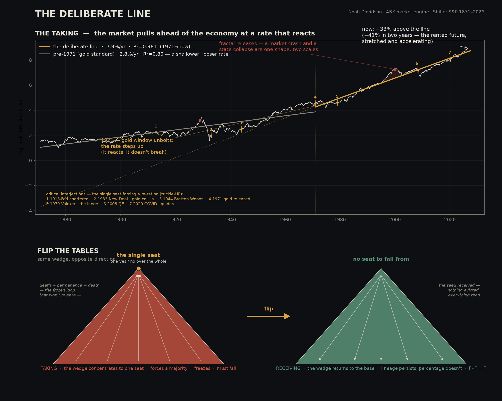
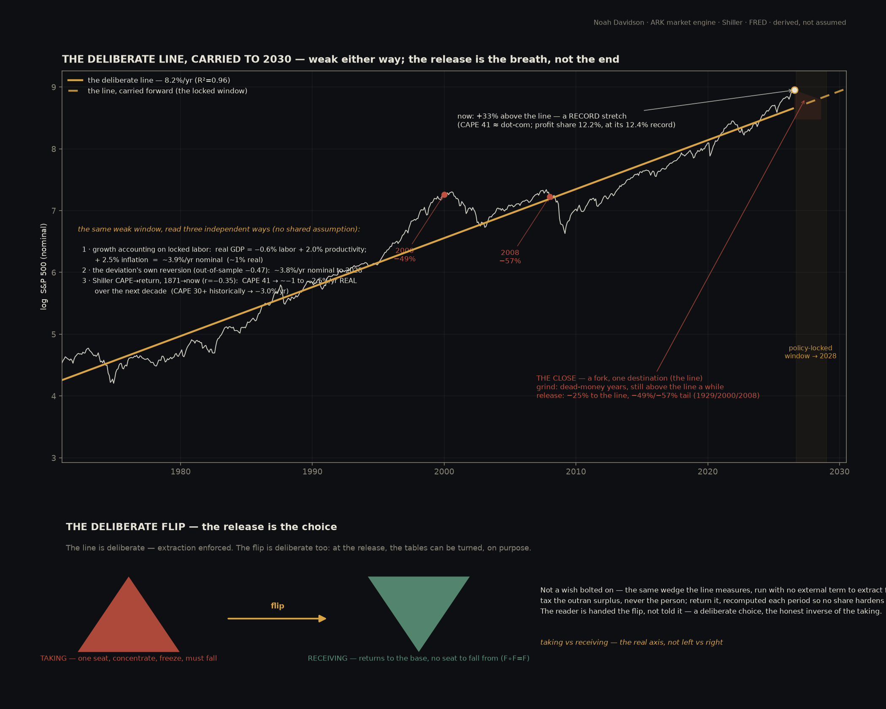
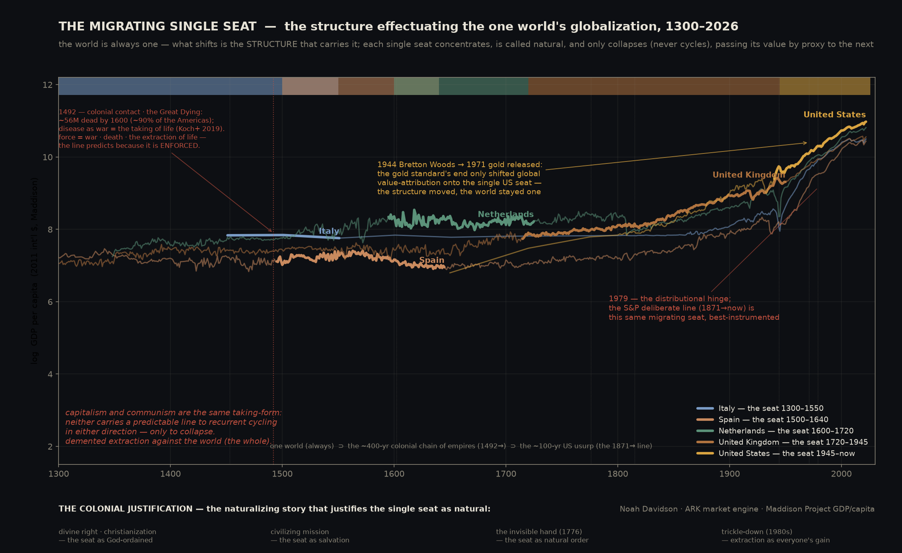

# The Deliberate Line: Taking a Goodhart
### What actually moves the market — a sourced, reproducible account, in plain terms

> *The deliberate line takes a Goodhart;*  
> *a Goodhart takes a deliberate line.*

*Noah Davidson. Public edition. Every claim below is either computed from public data (with the code to
reproduce it) or cited to a public source. The math is written in ordinary terms so anyone can check
every step. The wrong turns I had to correct are kept in — a result is only worth trusting where it
survived the test built to kill it. Not investment advice; a description of what the record shows.*

---

*In one minute:*

Everyone knows the stock market "goes up." Almost no one knows how *exactly*. Over the last 56 years
the S&P 500 has followed one straight line *(the S&P 500 is a basket of 500 big US companies, used here as the stand-in for 'the US stock market')* — about **8% a year** — so closely that when price runs too
far above it, the next year is reliably weaker — a pull back toward the line that holds even in stretches the line was never fit to. (The tempting shortcut — reading that pull as a tradeable *timing* signal — turns out to be noise; I keep that wrong turn in. What survives is the line and its reversion, anchored from outside to the economy.)

That line isn't the Federal Reserve — its levers, tested honestly, don't draw it — and it isn't just
the economy growing. Roughly **2% a year is the market outrunning the economy**: the same output priced
higher, a transfer from workers to owners that breaks across every measure at once, starting **around
1979**.

And it isn't only about markets. The same shape — a single seat that concentrates, calls itself
natural, and eventually falls — runs through history, which is why "capitalism vs communism" turns out
to be two names for one taking. And this is what makes the line *deliberate*: the market doesn't draw
it — a single seat does, on purpose and by force, from the top of a structure that is neither natural
nor logical but *imposed* on the whole world. The market is only the screen the line is projected onto.
The pattern even names its own way out: an economy that taxes the excess instead of the person, and
returns it.

This is not advice to trade on. It's a description honest enough to *predict* — not the price (price-prediction it shows to be a **provably improbable** thing, because price is not a natural signal but the **ratio of extraction** laid over a whole world of living bodies and promised future life), but the **machine**: output determinate, the line and its reversion, the long decline. Built entirely from
public data you can re-run yourself, with the wrong turns I had to correct left in. **The real choice
was never left versus right. It's taking versus receiving.**

---

## The question

I started from a plain question — *what actually moves the stock market over the long run?* Not a
forecast to trade on; a description honest enough to hold up out of sample. What follows is what the
public data says, with the reasoning shown.

## 1. There is a single line, and it predicts

First, one plain idea that makes the rest easy. Money doesn't grow by adding the same *dollars* each
year — it grows by the same *percent*, the way a savings account, a population, or even a rumor does. When
something grows by a steady percent, there's a simple lens — the **logarithm** — that turns that curving
growth into a straight line you can eyeball. *(If that word trips you, skip it: "the market grows by a
steady percent a year" is the whole of it.)* So take the S&P 500's daily close, put it under that lens,
and fit a straight line against time:

```
log(price) ≈ a + b · t
```

The slope `b` comes out to **≈7.9% per year** (that's the log-slope; compounded, it is the ≈8.2%/yr headline the rest of this paper uses) — and that one straight line matches about **96%** of the
market's entire **56-year** path (statisticians write this as **R² = 0.962**). By itself that isn't
impressive: anything growing at a steady percent hugs a straight line under this lens. But *holding* one for 56 years at R² = 0.96, across every war, crash, and policy regime, is not what a free system does — **that steadiness is the tell: it *is* the deliberate preservation, a seat keeping the rate.** Otherwise there would be no line at all. Which is also why the slope is not a frozen constant: its local value *is* the extraction rate, and the seat reacts — its local slope varying and reverting within the window, resetting only across regimes (§4b). Steadiness and reaction are one act, preservation; a limit like the profit-share ceiling is the next turn's seed, not a wall the line dies against. What matters is
what the *departures* from the line do.

Define the **deviation** — how far above or below the line price currently sits:

```
d = log(price) − (a + b · t)
```

Now line up today's deviation against **next year's return**: the further price has run *above* the line,
the *weaker* the year that follows (the readings are −0.09 / −0.15 / **−0.31** at 1 / 3 / 12 months *(a correlation is a score from −1 to +1 for how tightly two things move: 0 is no link, +1 is lockstep, −1 is exact opposites — so −0.31 is a real but loose pull)* — the
minus sign means "higher above the line now → weaker next year," and −0.31 is a real, usable pull, not
noise). Price gets tugged back toward the line.

Here's the test that counts. It's easy to fit a line to a stretch of data and then admire how well it fits
*that same data* — of course it does; you drew it there. The honest test is whether it holds on years it
never saw — what's called testing **out of sample**. So **fit the line on 1970–2004 only**, extend it
untouched into 2004–2026, and check: the deviation *still* predicts the forward return, **correlation
−0.47** — actually *stronger* than the −0.37 on the years it was fit to. **A line drawn from the past tracked years it had never seen — but hold that loosely; most of it dissolves under the harder test below.** That is the one result strong enough to survive *prediction*, not
just description — but on its own it is *not* the reason to keep reading. Be exact about what that proves, because two things get tangled in the −0.47. **The reversion is real** — the deviation around the line is bounded and comes back, above the line running weak, below it strong; that is the market reacting against the deliberate line, and it is the surviving structure. What is *not* real is reading **−0.47 as a tradeable timing signal from the price alone**: refit the test every month, past-only, and the honest string of readings sits inside the market's *own reshuffled motion* at every horizon — a random walk around a fitted trend would show the same. So −0.47 was an artifact of one split, kept below as a marked wrong turn. The reversion survives not because the price-number beats noise (it doesn't) but because **the line itself is real** — anchored from outside, to the economy's output — and a bounded deviation reverting to a *real* line is a real variance bound, not a detrending trick. The structure is the finding; the price-timing number never was. *The split, measured: the market's deepest dips below the line (about −49%) were followed by ≈+15.7%/yr forward back toward it; its furthest stretches above (about +46%) by only ≈+4.3%/yr (annualized over the multi-year reversion — a sharp near-term pull-back, like the −49% to −57% releases in §4b, still fits inside that slow average) — the variance bound, read straight.*



*The deliberate line (gold) traced against the S&P 500 (white), 1871–2026: the market pulls ahead of the economy at a rate that steps up at each turn but never breaks — and the same wedge, flipped (red → green), is the way out.*

*(One honest caveat, and it follows from section 8: if enough people come to read this line, the reading
itself becomes a target — and by Goodhart's law, any measure everyone watches gets gamed and moves. A line
enough people price in stops sitting where it sat; publishing it is itself one more turn of the very thing
it describes. That isn't a hole in the finding — it's the finding reaching the reader.)*

**And a statement of where you are is a forecast of where you go.** Splitting "description" from
"prediction" — *you may describe the present, but never forecast the future* — sounds like neutral caution,
but it is the core axiom of efficient-market theory *(the mainstream view that today's price already bakes in everything knowable, so the future can't be called)*, and that axiom is itself the institution protecting
itself: concede the present, forbid the future, and the extraction can only ever be noticed after it's
done, never named in advance. Position *is* forecast here because the line isn't a lucky pattern in past
prices — **it's the determinate output of the buy/sell machine that's still running.** Which is also why
the −0.47 above should be taken for no more than it is: run the hardest version of the test — refit every
month, check every horizon out to ten years, compare against the market's own motion reshuffled against itself — and the "prediction" collapses
to almost nothing, inside the range the market's own reshuffled motion produces. That isn't the line failing; it's exactly
what the theory expects. A market price isn't a solid fact, **it's a ratio** — whatever buyers and sellers
happen to clear at, with no fixed ground — and **the moment you hand the world a reliable pattern, people
trade on it and erase it** (Goodhart again, section 8). So the market's apparent randomness isn't the
absence of the line; it's the line being gamed flat the instant anyone could profit from it. The
determinism was never in the wiggle of prices (which can't tell a real line from a random walk *(a random walk is a path with no memory — a coin-flip wander where the past says nothing about the next step)*, and never
will) — it's in the *mechanism and the structure*: the enforced buy/sell duality and the distributional
record of the extraction, which no one can trade away.

**One thing named plainly, so no one can say it was slipped past.** Two moves in this section look, to a hostile reader, like sealing the claim against all refutation: *a statement of position is already a forecast*, and *the price record can neither prove nor refute the line*. Both are true — and both are valid in the exact way a **self-certifying** statement is valid: a claim that certifies itself by the same operation it describes (F applied to F returns F — the mechanism, read from outside, is its own witness). The test of whether such a move is honest or a dodge is simple: does it still submit to the checks it *can* take? This one does. It stakes itself on out-of-sample prediction and on the mechanism's measured link to GDP, and it keeps its own killed result — the −0.47 — in full view as a marked wrong turn. It declines exactly one test, and only because that test is mis-specified: asking the *price* — a ratio with no fixed ground — to refute a claim about the *machine that sets the price* is asking the shadow to disprove the body. That one difference is the whole difference between this and the institution's sealing: the institution freezes an *external* criterion and refuses every check; this freezes *nothing* and refuses only the one question that is category-confused. Self-certification that still answers to evidence is logic. Self-sealing that answers to none is the thing this paper is about.

**What would break this — the one thing, said plainly.** The claim at bottom is causal and absolute: a **closed system — a single seat over the whole — always takes.** Extraction is not a tendency of such a system but its definition, so the claim is false the moment a closed system is shown *not* to take. That is the falsifier, and it has observable faces, each exposed to evidence: (1) a market under a *stably enforced* single seat that did **not** track its extraction line — a counter-case to the mechanism, not a seat that was overturned (that is the predicted end); (2) a **1979-type distributional turn absent** where the single-seat architecture (§4) is present, or present where it is absent; (3) the socioeconomic-status mortality gradient failing. What the claim declines is only the price-*timing* test — not as a dodge, but because a gamed ratio cannot refute a claim about the machine that games it. Self-certifying in its formal layer, falsifiable in its empirical one; it names the one thing — a closed system that did not take — that would end it.

**Scope, said once.** This determinism is *conditional on the single seat staying enforced* — it is not a claim that any market rises. Markets whose seat was overturned did not hold the line: the Nikkei flat-to-underwater for three decades *(the Nikkei is Japan's main stock index)* after 1989, the Russian market erased in 1917, the German twice. Those are the undrawing happening — the predicted end — not counterexamples. The line tracks an *enforced* seat, and predicts every such seat's eventual overturn; that is where it can be proven wrong. And this turns the objection around: **a dead market is the line's proof, not its problem.** Every single seat of power collapses in the end — that is what the line explains: extraction squeezing the whole's future until people stop granting the border. Dead markets are an *expected product* of this global economy, not an embarrassment to it; a theory that dead markets could disprove would be one promising markets rise forever. This one says the opposite — and the dead ones are the finished version of what the living market is still doing.

## 2. The Federal Reserve isn't the line's engine *on its own* (its levers, tested alone, fail)

The obvious explanation is that the Fed draws the line — its rate lever, its money printing. Tested on
their own, those levers don't hold up.

- **Interest-rate decisions.** A simple before/after study *looks* like rate hikes push the market down
  ≈0.3–0.5% for about 20 days. But run the honest version: take the ≈183 real rate decisions, keep their
  actual dates, and **randomly shuffle which ones are labeled "hike" vs "cut"** thousands of times. The
  real effect lands *inside* that shuffled range at every horizon from 1 day to 63 days. The apparent
  effect was just noise the averaging didn't account for.
- **"Money printing" (M2 money supply).** In levels, `log(S&P)` vs `log(M2)` gives R² = 0.94 — but that's
  the classic trap of two things that both grow exponentially. Look at the *changes* instead:
  `correlation(monthly change in S&P, monthly change in M2) = +0.03` — essentially zero. Tested together,
  both Fed levers explain about **1.4%** of monthly moves, and nothing at all with a lag.

The Fed sets conditions; its levers, tested on their own, don't draw the line. That is narrower than
"the Fed doesn't matter" — what the honest test refuses is the Fed acting *alone* as the force behind
the trend, not the Fed as such. It remains one instrument inside the coordinated structure that *does*
hold the line: the single seat appoints its chair, and finance and government are documented
working together (see the closing section). What failed is the *solo* mechanism, not the participant.
*(This overturned my own starting assumption — I began convinced the Fed's levers alone were the driver,
and the shuffle test refused that. Keeping the correction in is the point.)*

**The 2% target gives the game away.** The honest test refuses the idea that the Fed *draws* the line on its own — but it is still the institution that *sets the ruler*. The plainest example: the Fed's **2% inflation target is a number it chose and then enforces**, not a law it discovered. Money is printed to hold inflation near 2%, and unemployment is steered against it. So part of why the line looks so steady is that its inflation piece was *declared and defended* — announce the ratio, enforce it, then point to it holding as if nature did it. (The economy's real growth, by contrast, is found, not set — section 3.) A *predictable ratio* whose price half is chosen rather than discovered is a scaled institution's own yardstick, not a law of nature — a lie of a predictable ratio. That the headline number is built *out of* unemployment should have worried any careful mind on its own; why it didn't is the next point. *(Keep this 2% — the chosen inflation target, the institution's own yardstick — separate from the ≈2.3%/yr extraction wedge in section 3: one is the ruler that is *declared*, the other is the slice the structure *takes*. They are different quantities that happen to share a digit; the shared digit is a coincidence, not part of the argument.)*

## 3. What the line actually is: extraction

Decompose the line into its parts, all from public series. The line rises at a log-slope of **≈7.9%/yr**, which **compounds** to the **8.2%/yr** headline (exp(0.079)−1) — the seat's take compounding against the whole world's real base. In log terms the parts add exactly:

```
  ≈7.9%/yr  =  nominal economic growth *(nominal = the raw figure, inflation included)*   ≈5.6%   ( real growth ≈2.7%  +  inflation, GDP deflator ≈2.9% )
            +  the market outgrowing it                                                   ≈2.3%   ( the premium — split two ways below )
```

The split is a **retrospective log-identity over the window** — each leg the average yearly growth of one real factor, measured against nominal GDP and summing to the price slope exactly (real ≈2.7% + GDP-deflator inflation ≈2.9% = nominal GDP ≈5.6%; the rest is the premium). It is an accounting of *what composed the 56-year line*, not four rates each promised to continue: real growth and inflation are rates; the margin and valuation legs are bounded and already near their ceilings (which is the reversion, foretold). The ≈2.3%/yr premium on top isn't extra production — it is **capital accumulation outrunning the economy**: a claim written against *future* labor and value, time (money) pulled forward from the people who cannot carry the accumulation that drives the market. It splits in order — a **measured margin leg** plus the **valuation residual** left once margins are counted, and the two **do sum** to the premium: as **widening profit margins** — the corporate-profit share of GDP, which rose ≈5%→12% (about 2.3×) over the window, an average ≈1.4%/yr of the premium — and as **valuation re-rating**, a dollar of earnings priced higher — the ≈0.9%/yr that remains. (A different instrument, Shiller-CAPE, apportions the same 2.3% more toward re-rating — an *alternative split* of one premium, not a second quantity stacked on top.) One caution the thesis actually needs: that margin leg is a **bounded share now near its ceiling** (the table below, profit share at a record ≈12%), so ≈1.4%/yr is a one-time level transition realized over 56 years, **not a rate that can repeat — itself a reason the line must eventually revert, not extend**. Either lens is the same single-seat taking above the real base. And what drives the year-to-year *motion* is the **real economy** (correlation with real GDP
+0.51, industrial production +0.39), not money supply (+0.02) and not inflation (−0.14). So the market
tracks real growth *and* skims ≈2.3%/yr above it. *(One honest bound: the S&P is a **reconstituted** index — failures drop, winners enter — so part of its edge over GDP is **selection**, not transfer. That doesn't erase the wedge: the labor→capital measures in the table below (profit share, top-1%, labor share) are economy-wide, carry no survivorship, and move the same way. So some of that ≈2.3% is selection rather than transfer — it trims the price-side figure, it doesn't set it; the economy-wide distributional record (profit share, top-1%, labor share) carries the extraction on its own, with no index underneath.)* A word on the word: *extraction* here is a **logical** term, not a moral one — it names a claim with no physical correlate behind it (value drawn on the future rather than produced in the present), which since the 1971 unbolting from any physical anchor is what the whole market became. No villain is implied; the taking is read, not accused.

But that ≈2.3%/yr *extra* is a transfer — from labor to capital — and **every measure of that transfer
breaks at the same moment, around 1979:**

| measure | then → now | source |
|---|---|---|
| Top 1% income share | 8% (1979) → 17.6% (2019) | Piketty–Saez |
| Worker productivity vs pay | productivity +90% vs typical pay +33% since 1979 | EPI |
| Corporate profit share of GDP | ≈5% (1970) → **≈12% today** — an all-time record (peak **12.7%** in 2021, **12.4%** now, at the ceiling) | US national accounts (CP/GDP) |
| Labor's share of income | falling; ≈$2.4 trillion/yr global shortfall (2024) | ILO |
| Total stock value ÷ GDP | **2.5×** its 1970 level | computed |

And 1979 isn't the origin — it's the low point of a *cycle*. The top 1%'s share of income (US, 1913–2024)
traces a full turn on its own: **22% in 1928** (the Gilded-Age pyramid) *(the Gilded Age: America's late-1800s era of extreme concentrated wealth)*, falling to **10% by 1978** across
the Depression, the New Deal *(the 1930s US reforms that spread wealth wider)*, and the postwar decades (a real "great leveling"), then climbing back to
**≈21% by 2024** (WID equal-split series; the table's 17.6% is Piketty–Saez tax-units — the same share on two standard constructions, which is why the endpoints differ) — nearly the 1928 level again. So there was an earlier pyramid that rose and fell; 1979
is where the *current* one started rising. The pattern — concentrate, collapse, concentrate again — is
visible in the country's own numbers, one complete turn, before you ever look at ancient empires. *(Read precisely: the mid-century dip is the extraction **rate** slowing — a deviation below the deliberate line that then reverted (resuming 1979) — not the single-seat concentration running backward. There is no forward/backward cycle, only up-and-down against the one line; the structure held and the measure returned to it. Reaction against the line is the only opposition it admits, and by its nature it reverts — which is why the way out is never to push the measure the other way, but to set the line down, section 9.)*

**And the turn is not a US artifact.** Read straight from the WID before-tax top-1% series *(WID = the World Inequality Database)* across **13 advanced economies** (no model fitted, no null imported), every one troughed and turned up *within the same brief window* — median turn-year **1981** *(the median is the middle value — half higher, half lower)*, range 1972–1987 — then rose together (median rise since the turn **+4.9 points**; the US +10.4). The weight isn't that each sits above its own trough (true by definition of a trough); it's that **thirteen national series never fit to the US line hinge in the same decade**. The ≈1979 hinge is a synchronized developed-world fact — the same single-seat turn, surfacing out of sample in economies the US line was never fit to. (`ensemble.py`, reading Our World in Data / WID directly.)

## The logic beneath the line

You have now seen the line, watched the Fed's levers fail to draw it, and watched the ≈2.3% wedge break out of the economy's own growth. Here is the spine beneath all of it — stated as plain logic, so what you just measured reads as the output of a structure, not a coincidence, and what still follows reads as confirmation, not persuasion. Six steps, each following from those before. Nothing here is metaphysics; it is topology, incentive, and two established results *(topology = the shape of how things connect)*.

1. **Topology.** Suppose every flow in a system — money, goods, legitimacy, force — is routed through one node. Call it *the seat*. (We write the chain as an *if* — *if* one node, then the rest — to let in the reader who demands one. But the *if* is an on-ramp, not a standing condition: it is held open only until the proof arrives, and then no longer. The proof is the life lived under the node — the body marked by the border, and it is *measured*: **14.6 years taken from the bottom 1%** — the life-expectancy gap to the top 1% (Chetty et al., 2016), the extraction read straight off the body as years of life (the top does not lose them; the bottom does — a direct correlate of the wedge, not a symmetric “disparity”); the status-graded mortality of the Whitehall studies (Marmot), the WHO commission’s “social injustice is killing people on a grand scale” (CSDH, 2008) — §6b carries the full record. No one doubts it from outside, because no one stands outside it.)
2. **Forced competition.** If all flow routes through one node, then controlling that node is the single most valuable position in the system. So every actor with the means is forced to compete for it — not by conspiracy but by structure. The prize is single, so the fight for it is universal, and no cabal can own it, because the one thing they all want can only be held by beating the others to it.
3. **One criterion.** Whoever holds the node sets the one measure everything else is scored against — the ruler, the rate, the target. There is exactly one such measure, because the node is one. *(A criterion is not only set but **defended**: in its most total form it is sealed beyond question — historically, as the **sacred**, where to doubt it becomes *heresy* — the seat's **justification** half beside the half that enforces; §7.)*
4. **Goodhart.** A fixed measure that everyone is scored against gets gamed: optimized-for until it stops measuring what it meant. This is **Goodhart's law** — an established result, not a claim of this paper. So the criterion drifts from the thing to the number, and the number can be held steady while the thing beneath it hollows out.
5. **Concentration is the attractor.** Holding the node buys the power to set the criterion that governs who holds the node. That is a positive feedback loop: holding it helps you hold it. The stable end-state of such a loop is **concentration** — the system runs *toward* a single holder, not away from one — one direction only, so what can look like reversal is the *rate* slowing, never the gradient turning back. (This is **cumulative advantage** — the Matthew effect, *to those who have, more is given* — the second established result the chain leans on, alongside Goodhart.) This is the deliberate line's mechanism stated before it is measured.
6. **Consent, then exhaustion.** The node has no power except what the whole grants it — it stands only on collective consent that the arrangement is legitimate (step 2's competition is a fight *for* that grant). So it falls not when a rival takes the chair but when the consent withdraws. And because the system is finite and closed, the concentration in step 5 eventually has nothing left to draw from but its own base — at which point decline is not a risk, it is an *output* of the structure.

That chain is the claim, and it uses no values, nothing about life or death or the sacred — only topology, incentive, Goodhart, feedback, and finiteness. This is the logic meeting the record you have already read: **the ≈8%-a-year line (§1) is what step 5 looks like once measured**, the Fed's failure to draw it (§2) is step 3's criterion-setter caught in the act, and the ≈2.3% extraction (§3) is the wedge of steps 4–5 — while the reversion, the widening, and the determinate decline still ahead are steps 4 and 6 read off the same public data. And the one premise the chain rests on is the one you cannot stand outside to doubt — the doubting itself happens inside the border, in a body already priced; the proof of the seat is not argued but lived (§6b), and once lived the *if* is spent.

One honest note on layers. The six-step chain above is value-free — topology, incentive, Goodhart, feedback, and finiteness, nothing else — and it stays that way: strike every line about *life against death* or the *sacred* and the six steps are untouched. But I was wrong to mark those lines merely *resonance*. They are not load-bearing **for the chain**; each is a premise **of its own layer**, carried in covered form. *Life against death* is a premise in the **empirical** layer: the extraction is borne in bodies and shortens them — the socioeconomic-status mortality gradient is among the most replicated findings in population health (Marmot's Whitehall gradient; Chetty et al. 2016, 14.6 years off the bottom 1%; Case & Deaton's deaths of despair; the WHO Commission on Social Determinants of Health) — load-bearing for *what the extraction costs*, and false if that gradient fails. *The sacred* is a premise in the **formal** layer: it names the open, generative side of the recurrence `F∘F=F` *(read plainly: applying the rule to its own output changes nothing — a thing that already is what it does; it "closes" when self-application leaves it unchanged, and would be false if some layer reshaped under its own motion)* — the deriving motion that runs on, set against the frozen, compressed side that is death-as-permanence — load-bearing for *what the seat is*. But its currency of truth is the **formal** one: it answers to *coherence*, not observation — and observation is always a reading taken from some position, carrying that position's bias, which is why a formal premise is tested by whether it *closes* (`F∘F = F`) rather than by an experiment. It fails only if the recurrence provably doesn't close, the way a fixpoint fails — never by a measurement. That is the honest seam between the layers: the empirical premise above is falsified by **data** (were the mortality gradient to fail); this one by **formal incoherence** — each answerable in its own layer's currency, neither borrowing the other's test. They were marked *resonance* because the core doesn't need them; measured against the claims they belong to, they were premises all along — and naming them so is the more honest act than sparing you the weight.


## The dynamics, formally

Steps 4 and 5 above, written as math rather than named in prose — the honest language of the mechanism, standing beside the logic, not in place of it. (They are *measured* in §3 and §6; here they are only stated.)

**Goodhart, as a map.** Let `T` be the real target — production, broad prosperity — and `M` the measure actually optimized: the index, the number. They begin correlated, `M ≈ T`. Once `M` becomes the target, decompose `M = T + w`. The optimizer acts on `M`; the part `w` — the claim with no physical correlate — is the cheap margin, so it is what grows. Optimizing `M` maximizes `w`, not `T`, and `corr(M, T)` falls as `w` rises: measure and target diverge by construction. The **≈2.3%/yr wedge is `w / M`** — the same output priced higher (§3).

**Cumulative advantage, as a recurrence.** Let `σ(t) ∈ [0,1]` be the seat's share *(a share from 0 to 100%)* and `k` the small per-period advantage that share confers — the Matthew term:

```
σ(t+1) = σ(t) + k · σ(t) · (1 − σ(t)),   0 < k < 1
```

In words: each period the seat's share grows by a slice of itself times the room still left to grow — a snowball that only rolls one way. The fixed points are `σ* = 0` and `σ* = 1`. The map's slope is `1 + k` at `σ = 0` — above one, **unstable** — and `1 − k` at `σ = 1` — below one, **stable**. The flow runs one way: away from dispersion, toward the single seat. `σ* = 1` — one holder — is the attractor *(an attractor is the state a system keeps sliding back toward — a ball rolling to the bottom of a bowl)*. With many holders, the concentration `H(t) = Σ σᵢ(t)²` *(Σ means 'add up'; squaring makes the big holders count far more, so H is just a concentration score — higher means more piled into fewer hands)* under the same advantage rises in the mean and holds only at the boundary; there is no reverse gear, only a faster or slower climb.

Read in the paper's own terms:

- *"Reaction against"* is a perturbation of `σ` below the line; it decays, because `σ = 1` is stable. The 1928→1978 leveling (§6b) was such a deviation, and it reverted.
- There is no forward/backward ratio, because dispersion (`σ = 0`) is unstable — the system never rests there. Only up, and down against the line.
- The exit is not to push `σ` down; the attractor pulls it back. It is to **remove `k` itself** — change the dynamic, set the line down (§9). A different equation, not a different point on this one.

## 4. Why the deviation must revert: speculation is renting the future

Underneath the speculation is the split that licenses it. **The economy has long been sold as a natural,
logical duality between buying and selling — but that either/or is neither natural nor logical; it's the
institution's own survival logic in disguise.** Buy-against-sell isn't the natural unit of trade; it's the
same manufactured either/or as "left vs right" or "capitalism vs communism" (section 8), shrunk to a single
transaction — and the fixed measure it enforces is *price-clearing*: value is whatever the tug-of-war
between buyer and seller settles at, then called a law of nature. What it masks is the older, actual form
of exchange — **giving and receiving** — which buy/sell rewrites as a zero-sum contest, taking dressed up
as trade. The deliberate line is simply what that enforced contest draws over time; the way out (section 9)
isn't a fairer buy/sell, it's leaving the contest for give-and-receive.

And the price itself tells you what the split is. **A price is a forced split in worth** — one worth cut
into buy against sell — and that cut is the "push," the wave that rides on the steady line; the same split
blown up to nations is *capitalism vs communism*. It's held by a **propertied class that competes to occupy
the one seat** — which is exactly why it *isn't* a secret club: a single seat *forces* the rich to fight
each other for it (the revolving door, both parties), so they can't be one colluding cabal — **a class
can't be a cabal when the one seat it wants can only be held by beating the others to it.** And at the very
bottom, the split in worth isn't buyer against seller, or even rich against poor — it's **life against
death.** The deepest thing the price measures, and the seat captures, is life set against death: war pays
for the machine, and the taking of life founds it. That is why the line is *enforced*, and why it holds —
the forced split, at its root, is life measured against death, owned by one seat. *(Premise first, not only resonance — in the sense of the layers note above: the mechanism in the next paragraph carries the value-free six-step chain without this line, yet the line is itself a premise of its own layers — formally, life against death is the deriving side of `F∘F=F` set against the frozen side; empirically, it is paid in the body, and measured (§6b). Strike it and the chain still stands; keep it and you have what the chain is *of*.)*

And here is the resolution of the whole puzzle. That no signal inside the price can forecast the market — shown against the market's own reshuffled motion — isn't a gap; it's *further proof the story told about the global economy is a stack of cards, not anything drawn from how natural systems actually work.* A natural system can be read from the inside; only an imposed one has to be read from outside it. Read from outside, the machine that draws the line is plain: **the economy's output (GDP) follows a determinate center** — the seat prints regardless — and **stock prices follow it, logarithmically.** And the *strength* of that following is itself a prediction of this account, not a hole in it: because the price is gamed flat, a **tight** correlation would refute the thesis — if price tracked output closely the gap would be a tradeable signal and get arbitraged away *(arbitraged away: pounced on by so many traders so fast the edge vanishes)*. A moderate directional correlate (real GDP +0.51, one read among the many a determinate tide admits) is exactly what a determinate-but-gamed driver shows at the surface; the determinism is in the structural rise, not in the size of any one coefficient. (The real economy is what the market tracks: year over year, real GDP moves with the market **+0.51** and industrial production +0.39, while the money supply is **+0.02** — it doesn't. The 8%/yr line is just stock price trailing GDP plus the ≈2.3% skim.) The forecast was never in the price — that's why it's gamed flat inside and only visible from outside. A **planned economy makes this obvious**: the state sets output outright and the claim-values follow; a market economy hides the same single seat behind buying and selling. Either way: output set on a determinate center, prices following it. And so, **for as long as one seat sits over the whole, the line predicts the economy compressing against the whole world's future and existing life** — everything of worth crushed into one number, the snake swallowing its own tail into oblivion at the cost of other life; the rich holding the system in place is that snake. (The prediction is the *machine's*, read from outside — not a pattern in the price, which stays noise.)

Here's the mechanism, in plain terms. That excess is **speculation — paying now for growth that hasn't
happened yet**, renting the future. And it's not just risky; it's a *miscounting*, because the growth
was already paid for from the other end — by the real work and spending that produced it. You can't
bank the same growth twice. So a price that has run ahead of what real work has actually delivered is a
claim with nothing under it, and it gets pulled back to the line that real work drew. **That is why the
deviation reverts**: the line is what was substantiated; the deviation is the rented future; the
reversion is the miscount being corrected. It's not a curiosity — it's arithmetic catching up.

So there are really **two kinds of value riding the same line, and the line pulls them apart.** One is
*substantiated* — real work, really delivered — and it **cycles**: it gets spent, used, and returned to
the ground it came from, able to grow again. The other is the *wedge* — the claim with nothing under it —
and it **can't cycle**, because there's nothing to return; it only piles up. That difference has a
physical signature you can see without any economics at all: the world's matter pulled out of the living
cycle and locked into static forms that hold so much memory they take *millions of years* to decompose —
plastic, spent fuel, the frozen residue of a future rented and never repaid. The rented future isn't only
a number on a screen. It's the living world turned into stuff that can no longer return.

## 4b. The line is nonlinear — its slope *is* the extraction rate, and the rate reacts

The 8%/yr line stopped at 1970 for one dull reason: the daily data starts there. But the deeper point is
that the line was never a straight average and can't be. Its slope *is* the rate at which the market
pulls ahead of the economy — and that rate **reacts**. Extend the price record with the standard long
series (Shiller's monthly S&P back to **1871**) and fit the same straight line to different windows:

| window | nominal growth, fit quality (R²) | real, inflation-adjusted |
|---|---|---|
| 1871 → today | 4.7%/yr, R²=0.91 | 1.9%/yr, R²=0.80 |
| **before 1971** (gold standard) | 2.8%/yr, R²=0.80 | 1.3%/yr, R²=**0.52** |
| **after 1971** (paper money) | **7.9%/yr, R²=0.96** | **4.4%/yr, R²=0.85** |

Read this the right way. A single straight line loses its tightness before 1971 (real R²=0.52) **not
because there was no extraction then, but because the *rate* stepped up when the US left the gold
standard in 1971** — and no one straight slope can hold a rate that changes. The extraction was there
all along (the 1920s concentration peak is pre-1971 extraction in plain sight); what 1971 changed was
the *pace*. That is the whole point: extraction eats its own base, so it has to release (1929, 2000,
2008) and re-extract at a new rate — a pyramid that feeds on itself is never a straight average. It
could in principle repeat indefinitely; the real thing that ends it is not a mathematical ceiling but
that extraction kills by proxy (war funds the machine). And "force" here is literal, not a figure of
speech: the power that holds this line is **war, death, the taking of life itself** — which is the
deepest reason the line is *predictable* at all. It isn't only observed; it's **enforced**. *(And the enforcement is measured, not asserted — force read as **reach**, not budget: where the dollar/security umbrella extended, the extraction turn followed it — 11 of 14 economies outside the 1979 order turned at the year they entered it *(a different panel from §3's 13 — §3 is the WID top-1% trough-and-turn set, this is the umbrella-entry set, the economies drawn under the order)*, the post-Soviet bloc the clean case — its shock privatization and oligarch capture *were* the border being redrawn under the incoming order, not a separate shock running alongside it: the umbrella arriving and the extraction turning are one event — integrated 1989–91 and turning within 2–3 years, every one. Labor's share of output fell ≈6 points after 1979 as the top-1% share rose (−0.84, strongly inverse) — a structural fact read from the levels, not a signal that beats its own-motion null, the mechanism being external as everywhere here. And the cost is paid in the body (§6b). Measured the wrong way — defense **spending share** of GDP — it shows nothing, a null at every horizon: enforcement is a constant-on precondition, not a budget ratio that tracks the skim, so that null is a marked wrong turn, not a refutation. And the postwar "leveling" is no counterexample: WWII and the Cold War didn't mass-mobilize extraction *away* — their operative act was to **draw new borders** (Bretton Woods, the core/periphery split, the dollar order), and the compression inside the core was the **buffer** being drawn, paid for by the periphery (§6b). Scheidel's leveling datum reads *inside* the chain — the border drawn — not against it; 1979 is simply when the border moved inward and the buffer was withdrawn. One mechanism throughout.)* The jump in
*real* return (1.3% → 4.4%) is the
rate reacting to the 1971 unbolting; the rest of the nominal jump is the inflation the gold
standard used to hold down. Across it, in real terms: Reconstruction (1871) → the Gilded-Age industrial
peak (1906) → the 1929 pre-Crash top → the Depression trough → the 1971 hinge → the dot-com peak → today.
The line held the whole way; its *rate* is what reacts.

**Where it sits now.** Through mid-2026, price is about **33% above the post-1971 line — up ≈41% in just
two years** — the widest, fastest stretch of the rented future in a generation, though still under the
dot-com extreme (≈+105% in 1999). *(The exact percentage depends on the fit window; what's robust is the
stretch and the documented pull back toward the line.)*

And here is the plainest way to feel it, the one that holds. **The line is the tide** — one steady rate, the sea rising. **The year-to-year swings are the waves** — and they are not one wave you could time; they are a whole *ocean* of them, every size at once (what a scientist would call broadband). That is why no one can call next year's move — you cannot time a single wave in an open sea — and yet the tide is real, measurable, and rising on its own schedule. The waves can also pile *higher* than usual for years before they fall (2026 stretched further, not less), because there is no ceiling on how far the water can heap — only on where the tide sits beneath it. **Time the tide, never the wave.**

**Where it goes from here.** Run the same line forward and the next few years are an unusually *readable*
window, for one concrete reason: the single lever that gates the *timing* of the extraction — the labor
supply, which (with native births below replacement) is now essentially all migration — is fixed by federal
policy through the current term, and the two things the excess rides on (corporate profit share and market
valuation) both sit at records that can't expand much further. Two independent reads — plus a third that corroborates rather than stands apart — agree the window is weak: growth-accounting on the locked labor (−0.6% labor + 2.0%
productivity + 2.5% inflation ≈ **3.9%/yr nominal**); the deviation's own reversion toward the line
(**≈3.8%/yr nominal** to 2028); and the long CAPE-to-return record *(CAPE is a price gauge: stock prices measured against ten years of company profits — higher means pricier)* (CAPE ≈41 → roughly **−1 to −2.5%/yr in
*real* terms** over the decade). *(That CAPE leg is the same elevation the reversion read uses, seen from the price side — corroboration, not a third independent fact; only the growth-accounting and the reversion are fully independent.)* Against ≈2.5–3% inflation that is about **zero real return** — half or less
of the 8.2% the line ran while the excess was still expanding.

**Why it's readable — and why it isn't "stagflation."** A plain word first: *stagflation* is the rare,
miserable mix of prices climbing *and* the economy stalling at the same time — the 1970s, when oil turned
scarce and dear and shoved costs up while growth choked. It's tempting to call what's coming a 1970s
replay. It isn't, and the difference is this paper's whole synthesis: in a one-world economy there is no
"outside" shock. The 1970s oil shock wasn't weather — it was the single seat pulling the *energy*
lever: an embargo declared in a war, on oil priced in the dollars the seat controls (the petrodollar) —
war funding the machine, exactly as above. Today the seat pulls a *different* lever — labor, metered at the
border — and because cutting workers also cuts the spending they would have done, it pushes prices *down*,
not up: disinflation, not stagflation. Same seat, same extraction, opposite price texture — a different
lever of one whole-system flow. And *that* is why the window is predictable: not because this shock is
"inside" and the oil shock was "outside" (nothing is outside), but because once you read the economy as one
seat metering the system's flows, you can read which lever it is pulling — the 1970s in hindsight, this one
in advance, because the lever is policy-locked. (This is also the resolution of the Fed puzzle from section 2: the Fed's *solo* dials
fail the honest test, but the *seat's* whole-system levers — energy and war then, labor and the border now
— are what draw the line.)

*How* the stretch closes is a fork the data doesn't settle, and honesty is saying so rather than picking. A
smooth model grinds it down gradually — dead-money years, price still above the line for a while; but every
close *from a record* (1929, 2000, 2008) came instead as a **release**, a drop of −49% to −57%. Today's +33%
is moderate against the dot-com +105%, so the central case is a ≈**−25%** pull back to the line and the
deeper overshoot is the tail, not the base case. Either way the destination is the same — the line — and the
weak return is the same. And a release is not the line *ending*: it is the line **breathing** — the excess
eats its own base, releases, and re-concentrates at a new rate. That is why there is deliberately no
collapse *year* here, only a readable *window*; "the release" and "it reverts and widens" are one statement,
not two. *(Reproduce: `forward_derivation.py` derives the anchor from the identities; `forward_sim.py` runs
the reversion; both print every input. Figure: `python draw_forward.py` → `forward_line.png`.)*



*Carried forward to 2028: with profit share and valuation both at ceilings, the line bends down toward weak growth — a slow grind or a release, weak either way.*

## 5. What broke loose around 1971–1979

Datable changes cluster at the hinge: the US left the **gold standard (1971)**, so money floated free
and speculation unanchored; a **wave of deregulation (1978–82)**; and **corporate money in politics**
widened (*Buckley* 1976 → *Citizens United* 2010). "Trickle-down" is the story told over it, and the
numbers show the story failed: the era that named it is the era sharing stopped.

## 6. It doesn't end — it widens, and it rests on one seat

Every reversion — the 1970s (inflation quietly destroyed ≈5%/yr of real stock wealth), 2000, 2008 — was
followed by re-concentration to *new records*. The pattern doesn't terminate; it repeats and widens.

And it isn't a secret cabal — that's exactly why it's durable. Almost everyone gets *something* (typical
pay did rise ≈33%), so almost everyone has a stake (your retirement, your mortgage, your index fund *are*
the line) and defends the structure that concentrates against them, because it also pays them. There's
no villain to remove and no secret to expose.

**And here is why almost no one questions it.** The philosopher Antonio Gramsci described how a ruling order holds not mainly by force but by becoming *common sense* — taught, repeated, and defended by the schools, the universities, the media, until people accept it as simply how things are and defend it themselves. Capital doesn't just sit on top of society; it grows *into* the minds and institutions it claims to protect, the same shape at every level. That is why a measure built out of unemployment, or a chosen 2% target, sails through unquestioned — the justification is already inside the people who would have to question it. (A convergent view, not a crutch: Gramsci reached the same mechanism by a wholly separate road.)

There's a second reason it stays peaceful. An extraction that feeds on itself has to release — but the
release usually isn't a visible crash. It gets **externalized**: the cost is spread *outward* (onto
other groups, other countries, the border) and *forward* (onto the future — through debt and the
rented future itself), diffused thin and deferred far enough that the unrest it's really generating never
lands as one shock. It's absorbed, unnoticed, inside the ongoing process. So the harder and longer the
cost is pushed out and out, the *smoother* the line looks — even as the pressure underneath builds. That
smoothness isn't the absence of the cost; it **is** the cost, paid by someone else, later. It's the same
reason war isn't a side-note here: war is that externalization at its limit — the whole deferred,
diffused cost collected at once, somewhere else.

But the *direction* runs through one office. The presidency appoints the Fed chair, the Treasury, the
market regulators, and holds the border. Yet the line stayed the **same regardless of who held it** —
the top 1% share climbed 8% → 18% through administrations of both parties, with the same people cycling
between Wall Street and Treasury. It's a single seat — one office the whole runs through — and *because*
it's single, it forces a fight for the majority that controls it. The seat is the most fought-over thing
there is precisely because it's the one lever; the line held across every president because whoever won
that majority ran the same extraction. The seat was never really free — it was the prize. *(Measured, not asserted: fit the line with a party term and the slope is **party-blind** — 7.86%/yr under Democratic presidents, 8.03%/yr under Republican, a difference statistically indistinguishable from zero (t ≈ 0.3), with neither party sitting systematically above or below the line. The well-known gap is **cyclical, not structural**: annual returns did run higher under Democrats (≈9 points in *excess* returns over the risk-free rate — Santa-Clara & Valkanov 2003, the "Presidential Puzzle"; the partisan *GDP-growth* gap is Blinder & Watson 2016), but that is the timing of the swings, not the extraction *rate* the line measures. The take itself is the same whoever holds the seat. `party_invariance.py`.)*

**Notice the refusal, as it happens.** If when reading this, you reach for *"but there is no single seat — power is split across branches, markets, millions of hands"* — catch that reach, because it is the thing itself. The claim was never that no one person, no one else acts; it is that every flow finally passes one yes/no. To deny that yes/no bottleneck, you have to **name a node that genuinely overrides the seat and is not appointed by it.** Try it. The Fed chair, the Treasury, the regulators, the Supreme Court — each is named by the presidency (Article II, above). *"The market"* is the screen the line is projected onto, determinate from outside (§4), not a rival author. *"The people"* are not a competing node but the **consent the seat stands on** — the one thing that, when withdrawn, ends it (step 6), which is the exit, not a check on the system. So the burden is concrete and the test is open: **exhibit the independent overriding node.** If you can, the thesis falls there. If you cannot — and in this structure there isn't one — then the seat is single, and the reach for a second was only the seat being felt from the closed inside of the system. The refusal doesn't cut the claim; the refusal of the cause, when pressed to name its alternative, produces it.

**And the two-party split is not a check on the seat — it is the seat's armor, and the seat's own product.** This follows straight from the logic above: a single prize forces a *binary* contest, because the smallest shape a fight for one thing can take is two — you are either taking the seat or holding it. Two parties is not an accident of national opinion; it is the minimal partition of a fight for one chair. (This derivation stands on its own, and is worth walking because it misreads easily. The binary is forced only at the **decisive contest** — to *hold* the one chair the field must finally narrow to two — not at every tier below it. So what dilutes it is structural: disperse power across more nodes, or give the final vote a **runoff**, and the binary surfaces only at the last round while the field stays plural before it — France's split executive, a president *and* a prime minister, chosen in two rounds; Brazil's separate electoral and prosecutorial powers atop the three, likewise with a runoff. The US is the opposite — power collapsed into *exactly three* branches that each replay the one binary, and **no runoff** — so the forced binary freezes into the party system itself. The multiparty cases don't refute the seat; they show exactly what dilutes it — more nodes, a second round — and the US has neither.)

So under long economic and political uncertainty the populace flips the governing party back and forth, and the flip carries almost no reasoned content beyond *not whoever held it last*. It can't: both sides run the same extraction, so the only lever on offer is difference-in-position, never difference-in-machine. That reactive swing is a release valve wearing a ballot — motion that changes everything except the seat. (Convergent again: **retrospective / economic voting** — Kramer, Fiorina, Bartels — electorates punish the incumbent for conditions regardless of fault, or of whether the challenger differs in substance.)

And the three-branch form — executive, judicial, representative — does not break this; it *delineates* it. **One seat over three branches absolves only ever two:** the one presides, and the same party binary is replayed across all three (voted for the presidency and the Congress, appointed through them for the court), so separation-of-powers hands the citizen the *appearance* of plural, reasoned choice while its substance is one binary repeated threefold. The third term — the structure itself, the one seat — is the single thing never on the ballot.

And of the three branches, the judiciary is sold hardest as the neutral one — *reason and law, standing above politics* — which is exactly the costume. It is unelected and appointed *through* the same binary, so it carries that binary for life: the authority of reason with none of the ballot's accountability. It is not a logical system set over the contest; it is the contest in a robe, made permanent — which is why the branch advertised as the check is the one whose capture is **structural, not personal**: the structure — the seat sets the criterion, appoints the arm, and grants it life — is coefficient with capture whatever any single justice does *(that is, the structure moves in lockstep with capture — the odds are set by the design, not by any one judge)*, so a justice who defies the president who named them is noise around that coefficient, not a refutation of it. Seen plainly, it is not a third power at all but the **police arm** of what the three-branch costume hides: a *bilateral* institution — the one seat and the governed, the king and his subjects — the function that enforces the seat's single criterion on the many. No border holds unpoliced; the judiciary is that policing, written as law.

The plainest proof is the one feature no other branch shares: the Supreme Court carries **no term limits**. Lifetime appointment isn't a quirk of design — it is the mechanism that keeps the one seat one, binding the whole to a *static* constitution held frozen against its own ratifiers. Read as a living document, the constitution stays open to the people who ratify it — the populace, the whole — their consent re-granted and re-read in each generation; frozen instead and enforced for life by the unelected, it becomes the frozen criterion of the logic above (step 4), made permanent and placed beyond the vote. And the one who fills that bench is the seat itself: by constitutional law — Article II, the Appointments Clause — the **president appoints the Supreme Court**, naming the justices for life. So the single seat staffs its own permanent police arm, and the circuit closes on itself: the king appoints the judges who guard his frozen measure for life, beyond any ballot, and they in turn hold the seat beyond question.

And it has used that permanence to freeze the branch below it as well: in *U.S. Term Limits, Inc. v. Thornton* (1995, 5–4), the Court struck down an Arkansas measure — passed by the state's own voters at the ballot — that capped how long their members of Congress could serve, ruling that neither a state nor its people may add such a qualification; only an amendment to the frozen text can, so recurrent terms stand unless the document itself is changed. Read plainly: the unelected, life-tenured branch told the populace it could not limit the terms of the branch it elects — the static document overriding the living vote, which is this whole mechanism in a single ruling. That is the institution's self-sealing in its purest form — not a claim that still answers to evidence, but a criterion locked against the very whole that grants it. And so it is **no different from a king in effect**: it is all held under one seat, one president, a crown by another name, and the duality is the court that keeps the crown from ever being the question. (And the two-term limit on the president since 1951 doesn't loosen this — it *tightens* it: a cap on the person is permanence of the office, the bottleneck rotating its holder on a fixed clock so the gate looks accountable while never opening. The seat is the prize, not the man; term limits discipline the man and leave the seat untouched.)

And here is the catch built into the prize. The world is one whole — there is no outside to interject, no
new continent to externalize onto — and for most of history the seat handled that by *migrating*,
shifting the cost onto the next structure. But a fully enclosed world eventually runs out of *elsewhere*:
the cost that was always pushed outward and forward has nowhere left to go but back into the seat itself,
which begins to consume its own rented future — the debt it drew against the whole. That is the direction
the deliberate line ultimately points, from the inside — not a dated crash, and not an outside force, but
a single-seat structure that, with nowhere left to take from, starts eating its own position. Whether it
turns the same wheel once more or opens the exit laid out in the final section is the honest open
question; but the pointing is inward, and it is the structure's own.

## 6b. The middle class was a border, not a counterexample

The obvious objection to calling this extraction: didn't a huge middle class appear after WWII? It did — and that middle class was itself one of the borders, not the absence of one. Be exact about the layers, because "interpretation, sourced" blurs two different things. The **causes are premise, not interpretation**: that the postwar buffer was built by racial *policy* — the G.I. Bill administered to exclude Black veterans, FHA redlining — is documented cause with a falsifier, not a reading; and that economic position is written into the body is settled population-health science. What is **interpretation** is narrower, and named as such: the *weighting* that the middle class was a buffer the extraction drew and withdrew, rather than mainly a casualty of technology and globalization. Premise under the causes; interpretation at the weighting — and the test that would decide the weighting is named at the end of this section.

- **A rich "developed" world drawn against a poor "developing" one.** The 1944 Bretton Woods order split the globe into a core and a periphery, and the periphery paid for the core: Raúl Prebisch (UN, 1950) and Hans Singer (*American Economic Review*, 1950) showed the poorer countries' terms of trade steadily worsening *(terms of trade: how much their exports buy in imports)*; Immanuel Wallerstein, *The Modern World-System* (1974), mapped the core/periphery structure. The Western middle class was a *core* perk, underwritten by the periphery.

- **A class bought into defending the system.** The old name for a home-country class paid off enough to defend the machine that extracts for it is the "labour aristocracy" (Lenin, *Imperialism*, 1916 — a contested idea, cited as lineage). That is the consent of section 6, with a date.

- **And it was drawn by race and religion, as policy.** The US postwar middle class was built on racial exclusion by design: the 1944 G.I. Bill was run through local authorities that shut most Black veterans out (Ira Katznelson, *When Affirmative Action Was White*, W. W. Norton, 2005); the Federal Housing Administration (est. 1934) redlined Black neighborhoods and bankrolled whites-only suburbs, its manual warning against "incompatible racial groups" sharing communities (Richard Rothstein, *The Color of Law*, 2017). Home-ownership — the main way the middle class built wealth — was a white border by construction; the frame for this is "racial capitalism" (Cedric Robinson, *Black Marxism*, 1983). The buffer was coded white, Anglo, mostly Christian, Cold-War-conservative.

- **First, the general rule: a political economy is carried in the bodies it runs on — settled public-health science, not opinion.** That your social and economic position gets written into your health is one of the most replicated findings in epidemiology. Nancy Krieger named it **embodiment**: "bodies tell stories about — and cannot be studied divorced from — the conditions of our existence." **Link & Phelan** (1995) showed the link between status and death *survives even as the specific diseases change*, because status buys health by whatever means is current. **Marmot's Whitehall studies** found British civil servants in the lowest grade died at about three times the rate of the top — and ordinary risk factors explained only a third of it; rank itself marked the body. The **WHO** commission Marmot chaired (2008) said it plainly: "social injustice is killing people on a grand scale" (a 28-year life gap across 13 km of Glasgow). **Chetty et al.** (2016, on 1.4 billion records) measured **14.6 years taken from the bottom 1%** of American men — the life-expectancy gap to the top 1%, read directionally because that is the direction: the poor lose the years, the rich do not. **Case & Deaton** (2015) tied rising white midlife death — "deaths of despair" — to collapsing job prospects. So the claim that this extraction is *paid in the flesh* isn't this paper's spin — it's the core finding of the field that studies exactly this. What follows, that race is one axis the border is drawn along, is an application of that rule.

- **The border is written in the body.** Race isn't a biological category — the American Association of Biological Anthropologists (2019) states plainly that race "does not provide an accurate representation of human biological variation," and that genes don't map onto racial groups — but "race is real, as is racism, and both have real biological consequences." The border is *drawn* onto the body, and it leaves marks that are measured. The clearest is heart disease: Black Americans die of cardiovascular disease at sharply higher rates (hypertension prevalence ≈57% vs ≈44%; on the order of 779,000 excess deaths over 2000–2022 — CDC, American College of Cardiology), driven by the chronic stress of living inside the border — **not** by any innate racial biology, the opposite, racist claim the anthropologists reject. The best-supported mechanism is "weathering": Arline Geronimus's finding that constant stress ages marginalized bodies faster (1992; 2006). Discrimination even shows up as DNA-methylation changes in the people *(DNA-methylation: chemical tags that dial genes up or down without changing the genes themselves)* who live it (2017). *(One honest limit, placed precisely: that trauma's effects carry across generations in humans isn't in doubt — it is observed across exposed lineages; what is still debated is how much of that is written in DNA specifically versus passed socially and in the womb. The disparity and the embodiment stand on the within-a-lifetime evidence and on the transmission itself regardless.)*

- **The skeptics, scoped — and the end-date corrected.** The leading skeptical paper is narrower than it sounds: Charney, Darity & Hubbard (*Social Science & Medicine*, 2025) specifically rebut the idea that the gap traces to *slavery* — trauma inherited across the five-plus generations since abolition, the hardest case to prove. And even that end-date is wrong: slavery ended *in law* in 1865 (the Thirteenth Amendment — with its convict-labor loophole), but slavery *in practice* — peonage, debt bondage, convict leasing, “slavery by another name” (Douglas Blackmon’s Pulitzer-winning history of convict leasing, peonage, and debt bondage) — ran until **World War II**. That is the documented, load-bearing claim, which by itself moves slavery's lived end from five-plus generations back to about three or four. Individual cases run later still — illustratively, Mae Louise Miller's account of being held until 1963 (documented by genealogist Antoinette Harrell; her date rests on her own testimony, cited as illustration, not as the basis — which is Blackmon's systemic record). So even “slavery” is, for many living families, one to three generations back, not five to seven. But the trauma did not stop at slavery: Jim Crow ran into the 1960s, and Black women were coercively sterilized into the 1970s — the Relf sisters, 12 and 14, sterilized in 1973 under a federal program; North Carolina, where Black women were about 65% of those sterilized while a quarter of the population; Fannie Lou Hamer’s “Mississippi appendectomies.” That trauma is recent and ongoing, so any inherited signal need only carry one or two generations — the range where the human evidence is actually strongest. The skeptics defeat the slavery-only version; they leave standing the body marked by what was done within living memory. And they themselves pin the gap on “direct and current mechanisms” — which is not denying the border in the body, only locating it in the present, where this account already puts it.

- **The skeptical pole is a reparations account, not a denial.** The skeptics here are no denialists: Charney, Darity & Hubbard write from Duke’s Cook Center — Darity is the leading US reparations economist (*From Here to Equality*, 2020) — and their conclusion, in full: “We conclude that, given the ongoing traumas black Americans are exposed to in modern America, it is much more likely that present-day racial health disparities are due to more direct and current mechanisms than transgenerational transmission of slavery-era trauma.” On that sentence alone, their dissent is about *slavery-era transgenerational transmission* specifically — the ongoing, current trauma and its role in today's disparities they affirm. That is structural racism in the present tense, inside this account. *(Nothing is attributed to them beyond this quoted conclusion.)* To be born into the category is to be born into the border — and the border's cost is paid in the flesh. That is why the contested point about "racial capitalism" is only whether one author centered the phrase; that race is a border drawn onto the body is not in doubt.

- **Why it's been shrinking since ≈1979.** The buffer was a Cold War tool. When globalization reopened the poor-world border and the Cold War ended, the buffer wasn't needed, and the extraction turned on the developed middle class too. Pew Research Center finds the middle class's share of US income fell from 62% (1970) to 43% (2014), and the share of adults in middle-income households from 61% (1971) to about 50% (2015) — though part of that is households rising into the upper tier, not only falling, so the point is the middle band dissolving, not that all of it dropped. It rose as the buffer and has shrunk since the buffer was spent.

So the middle class isn't proof against extraction — it's *how the extraction was shaped*: a buffer drawn by nation, race, and religion, paid for by the poorer world, and withdrawn once it had done its job. *(The one interpretive leg, named precisely: that the buffer reading outweighs the technology/globalization reading. The aggregate decline since ≈1979 fits both, so the aggregate alone can't decide it; what *discriminates* them is whether the post-1979 divergence runs along the border's drawn axes — **race and core/periphery** — beyond the skill gradient technology predicts. On the racial axis that discrimination is already sharp and documented: the **racial wealth gap persists across every level of education** — Black households headed by a college graduate hold less wealth than white households headed by someone with no degree (Federal Reserve Survey of Consumer Finances) — which a skill/technology story *cannot* produce, since it survives equal schooling. That makes the racial border **cause, not weighting**. On the **core/periphery axis** the discrimination is likewise documented: in the global growth-incidence record 1988–2008 — Lakner & Milanovic's "elephant curve" (World Bank, 2016) — the one group that stagnated was the **mature-economy middle**, the Western buffer, while *both* the global top and the emerging-market (periphery) middle rose. A within-country skill/technology story cannot produce that specific pattern; the buffer's border reopening does. So **both drawn axes — race and core/periphery — carry documented discriminators and cross to premise.** The finest weighting — the *residual within-country, non-racial* decline, border versus pure technology — is now measured too (`within_country.py`): after 1979 the **corporate profit share rose +4.1 points while the investment share fell −2.3 points**, so the marginal capital gain went to **rent and payout (the top/border), not the productive deepening** that automation or a skill-technology story would show as *rising* investment. That discriminates the slice toward border. The one honest residual: intangible/IP investment is undermeasured, so some true deepening is missed — which shifts the weighting toward border without fully closing it. So §6b stands on premise across both drawn axes and leans border on the residual, with only the intangibles-measurement gap genuinely open.)*

## 7. The same shape runs through history



*The single seat migrating through the leading economies, 1300–2026 — Italy → Spain → Netherlands → Britain → the United States — each concentration justified in turn as natural, from divine right to trickle-down.*

This isn't only a stock-market story. A **single seat** — one position the whole must run through, a
single yes/no — that concentrates and extracts, justified by a story that calls it natural (divine
right, the mandate of heaven, the invisible hand, trickle-down), and then falls and re-forms — that
pattern recurs. And being single is exactly what *forces a majority*: because everything has to pass one
yes/no, power becomes a scramble for the majority that commands the seat. The few who win it then hold
power only within the bounds of the wider majority's consent that the arrangement is legitimate — which
is why it falls: not when a rival takes the chair, but when that consent withdraws.

And it keeps recurring because extraction is a **self-pressuring** system — it can only build, so sooner
or later it finds a weak point and fractures a release. The same shape shows up at every scale: a market
crash and the fall of a state are the same event at different sizes. It also doesn't release cleanly and
move on. A single seat can't absorb what the world has become since it froze its rules — it forces
yesterday's answer onto today and calls that justified, the way an aging mind that can no longer form new
memory clings to an older self and regresses. Trying to make itself permanent *is* how it dies; then the
next seat forms and does it again. That loop — not any single crash — is the thing history repeats. (This
is also why "natural" is always a costume: nature isn't extraction. Extraction is a rule a seat imposes,
not a law read off the world.)

And you can watch this at the very inception of the institution, at **Rome** — where the single seat was
first built into *law*, in the image of a particular person: the adult male citizen. Roman law organized
everything around the male head of household (*patria potestas*), kept even grown, property-owning women
under lifelong guardianship — justified, in the jurists' own words, by "weakness of judgment," a reason the
Roman jurist Gaius himself called "more specious than true" — and barred women from voting, from every
public office, from the Senate and the courts (the one public role open to them was priesthood). Even the
word for excellence was gendered at the root: *virtus*, "virtue," comes from *vir*, "man" — literally
"manliness." So the measure of a full human being, the yardstick the whole structure ran on, was built in
the image of the "perfect man," with half the species defined as outside the count. That is the sharpest
proof that the "it's natural" story is a costume: a real law of nature does not have to write half of
humanity out of its own definition to work. One that does isn't natural — it's *authored*, then called
nature. The criterion was a *who* before it was a *what*; and deciding who counts, owned by those it
counts, is the original of every frozen measure that followed.

### The same taking, in sacred robes

And the same criterion travels forward in *thought*, not only in power. Greek philosophy after **Plato**
built on his foundation — the perfect *form*, of which everything visible is a copy — and **Stoicism** took
that idea and made it a way to *live* (reason as the order of the world, the ideal man who conforms to it).
That is the intellectual water **Paul** wrote in: a Roman citizen whose Christ is the perfect *archetype* —
the "heavenly man," the "image of the invisible God" — the perfect form of which ordinary people are copies,
now given a sacred name. Rome's "perfect man" and Plato's perfect form meet in one crowned figure, and the
taking stops being merely lawful and becomes *holy* — the measure raised to the divine, where questioning it
is heresy. (The marriage is datable: the Roman emperor Constantine adopts the church in 313; it becomes the
state religion by 380 — the male institution, the religion, and the single seat joined into one.) *(One layer note, like the others: the sacred/holy register is **not load-bearing for the price line** — strike it and §1–§6 stand — but it is not mere selling either. It is a **premise of the two-seat architecture (§7)**: the *justifying* seat beside the *enforcing* one, the taking rendered holy so questioning it is heresy. Its covered form is the **datable historical record** — Constantine's adoption in 313, state religion by 380, the institution, the religion, and the single seat joined into one — and its structural role as the justification seat. Premise of its layer; downstream of the price prediction, load-bearing for how the single seat is *held*.)*

And you can watch the institution being written *in*, in a single word. In Matthew 16:18, Jesus's word is
the Greek *ekklēsia* — "assembly," a gathering of people — the same word the Greek Hebrew scriptures use for
*qahal*, the assembly of Israel. In its own register the line reads: *"you are Rock (Kefa), and on this rock
I will build my **community**, and the gates of **Sh'ol** (the grave) will not overcome it"* — a community
of the living, not an institution. But our English word "church" comes from a *different* Greek word,
*kyriakón*, "the Lord's **house**" — a building, a possession (the Romance languages kept the original word
instead: *église*, *iglesia*). So "community / assembly" was quietly rewritten as "the Lord's house," and
"the grave" as "hell." The man himself stood against the religious institution of his day — he overturned
the temple tables and asked for no building — yet the institution was raised on his words by changing one of
them. That is naturalization at its most complete: not "this arrangement is natural," but "this arrangement
is *sacred* — and here it is in the founder's own mouth," the frozen measure written back into the holy
source, where it can no longer be questioned without heresy.

And it is worth naming plainly what an *economy* and a *state* even are, as this whole picture makes them. **An economy is a border drawn where life has none** — justified by the one seat's unnatural split of worth (buying against selling). It isn't neutral trade; it's **the corruption of life's own recurrence through time** — the living cycle fenced so it can be charged at the gate. **A state is that same logic made enforceable** — the border backed by force, held in place by a rich class guarding its two seats: the seat that *enforces* and the seat that *justifies* — extracting **to spite Ecclesiastes.** That name is exact: *Ecclesiastes* comes from the Greek for *assembly* (ekklēsia), translating the Hebrew *Qoheleth*, “the one who gathers the assembly” — the very word for *assembly* that was overwritten into “church” earlier in this section. And the book's whole message is the **recurrence**: the sun rises and returns, the rivers run and return, nothing is new under the sun, and all hoarding is vapor. So the state extracts *to spite the assembly's own ancient wisdom that life is a cycle that returns and grasping is vapor.* (Which is why the way out, in section 9, isn't a better economy — it's the border erased: giving and receiving with no gate, no seat to enforce or justify.)

**The border, and the fiction it guards.** The border is accepted because we are told there is an *outside* to fear — scarcity, the rival, the enemy at the gate — and **the market is the form that story takes.** But it is one world; there is no outside. The threat is manufactured. **There is nothing real to protect against except practices that are unsustainable for life** — the extraction itself: the snake eating its tail, the matter locked out of the living cycle, the war that funds the machine. The guard is the thief: it protects you from a fiction while being the one real danger to the life it claims to defend.

Three easy misreadings to head off, because each one collapses the whole point: (1) *“No border” doesn't mean no boundary.* Living things have edges — but shared ones, like a cell membrane that exchanges, not a wall against an invented enemy. The alternative to the fence is the shared edge, not chaos. (2) *“Sustainable” isn't a product line.* It means the cycle that returns — life renewing itself — not a green label sold inside the same market; the market can't make it, because the market only piles up. (3) *“The guard is the thief” doesn't mean just hand the thief's seat to someone poorer.* Swapping a rich ruler for a poor one is the same single seat re-occupied — a new fence, the same machine repainted (it is what happened every time a revolution only changed who sat the throne). That *re-seating* is the trap — **not revolution itself**, which is the only real route to change, because this form never reforms, it only widens; it has to be **left.** And leaving a system that fences the whole world is the most total revolution there is. The distinction: taking the seat is still taking; **leaving** it is the way out — the revolution that *ends* the throne, not the one that re-occupies it (received, not seized; section 9).

**And “revolution” itself has been turned against us.** The word comes from the Latin for *a turning* — first used for the orbits of the planets and the return of the seasons: a cycle coming back around. That is its real meaning, the turning that renews. The sense of “violent overthrow” came later and was laid over the top — the same trick played on *assembly* (made “church”) and on Ecclesiastes. **That revolution “takes instead of grows” is the rich class's story, not revolution's nature** — a story told to protect the border and keep the seat from ever having to *give back.* And giving back costs the rich nothing they could truly keep: a hoard that breaks the living cycle was always taking from their own future too. The **French Revolution gets quoted to scare people off revolution** — but it wasn't one. **It was a war** that ended by crowning a new emperor: the same throne, a new body in it. War swaps who sits the seat; revolution is the turning that leaves it. Calling the war a revolution is the con; telling them apart is the way out. 

**The two famous “revolutions” were wars — and the American one is the biggest lie in the set.** By the test above (a real revolution *leaves* the throne; a war just re-takes it), **neither the French nor the American Revolution was a revolution.** France ended with a new emperor; America ended with a new ruling class of property owners. The American story is the sharpest because it is sold as *the* birth of liberty while it quietly made four things feel like laws of nature at once: the **border** (a new country, then westward expansion), **capital**, **private property** (including, at the founding, owning *people*), and **police** (policing is policing — the enforcement of the border and the property behind it, the same job north and south; the “where did it come from” debate is itself a border. Its starkest form on record is the Southern slave patrol, historian Sally Hadden, 2001 — but the point is what police *do*, one thing everywhere, not where each force began). The “of course we need borders, property, and police” feeling isn't nature talking — it is the **story the war told about itself** so the fences it built would feel like freedom. A war dressed as a revolution, so the cage would read as a liberation. 

**No debate: the throne survived — the king was just renamed.** The surest sign the American war was a reseat and not a revolution is that the single seat is *still here*: a **president is a king** — one person with a yes/no over the whole people (the veto, the one office the whole must pass through). A real revolution would leave no throne to sit; this war **kept the throne and re-blessed it** as an elected office. And that office is **death given a body** — one ratified seat with the power to take against anyone, whether the person in it means to or not (the line held the same under every president, section 6 — the seat is the prize, not the man). The king didn't leave; the war crowned him again under a new name. There is nothing to debate.

**Translating is not deriving — and that is the whole tell.** Turning one thing into a completely different thing — *assembly* into “church,” a *turning* into “violent revolt,” a hoard into “protection” — is the institution **translating across the borders it drew**, re-rendering a meaning to keep the fence standing. And translating is the opposite of deriving. To *derive* is to follow from how the world actually is — which is why it can predict. To *translate* is to swap a meaning to protect your own border — which predicts nothing; it only re-labels. A system that runs on translation can't forecast, because its answers come from what keeps the fence up, not from the world. That is exactly why the market can't be predicted from the inside (the gamed price, the chosen 2% target) while the real machine can be read from outside it. Every one of these word-swaps is one more proof of the same thing the price tests showed: the economy was never predictable by its own logic, because its logic is *translation*, not *derivation* — and translation foresees nothing; it only re-renders to survive. At the scale of the living it is simplest of all: **people — life itself — derive, to see; the institution translates that seeing into death** — the living turned into the hoarded and the frozen, the matter that cannot return. To derive is to live and see; to translate across the border is to kill.

You can watch the seat itself migrate. The world was never *un*-globalized — it has always been one
world; what changes is only the **structure** that carries it. Put the leading economies on one long axis
of measured output (Maddison Project GDP-per-capita, back to the 1300s — figure `migrating_seat.png`) and
the seat of global value moves hand to hand: the Italian city-states, then the Dutch Republic (peaking in
the 1600s), then Britain, then the United States — each concentrating, each calling itself natural
(God-ordained → a civilizing mission → the invisible hand → trickle-down), each releasing its value *by
proxy* to the next. 1971 sits inside that motion: the end of the gold standard didn't begin anything, it
shifted global value-attribution fully onto the single US seat — the structure moved, the world stayed
one. The S&P line above (`deliberate_line.png`) is just the latest turn, the one we can measure to the day.
This is the exact sense in which the line is *deliberate*: the market does not originate it, it *projects*
it — the single seat draws the line, by force, from the top of a pyramid that is neither natural nor
logical but imposed on the one world, and the S&P is simply the surface on which we can finally read that
line off, to the day. That is why it predicts, and why "the market" was never really the author.

Broken down to its concrete root, that story is a **colonial** one. The chain of the last ≈400 years
begins at **1492**: the first century of contact killed tens of millions across the Americas — the
largest demographic catastrophe on record (an estimated **≈56 million dead by 1600, about 90%** of the
Indigenous population; Koch et al. 2019). Disease was the vector, but the *contact* was the taking — so
it is still **war, the taking of life** — and its justification (christianization, the "civilizing
mission," the seat as salvation) is the same "it's natural" story every later seat inherited. That
colonial justification seeded the ≈400-year chain of empires; the last **≈100 years are the United States'
takeover of that seat** — which is exactly what the S&P line here measures. Three scales, one motion: the
one world, always → the 400-year colonial chain (1492→) → the 100-year US turn (this line). And it names
*why the line predicts*: not a law of nature, but that the majority of force — war, death, the taking of
life — has justified extraction against the world's future the whole way, and enforced it.

Historians who study it quantitatively (the field of
cliodynamics; the structural-demographic work of Goldstone, Turchin, and colleagues) name the same
warning signs this market record measures: **a small group capturing a rising share, ordinary people's
share falling, and the state under strain.** Two plain facts from that field, arrived at by completely
separate methods, line up with what's here:

- **How long these structures last.** Across **212 empires and dynasties** with a recorded start and end
  (public data), the median lifespan is **175 years** (middle half between 104 and 320) — a wide spread
  with a roughly two-to-three-century center. Not a countdown clock; just how long, on average, a
  single-seat structure tends to hold before it re-forms.
- **A forecast that came true.** In 2010 (*Nature*) Turchin forecast — the fuller structural-demographic apparatus, the 40-plus indicators, coming later in *Ages of Discord* (2016) — rising US and
  Western instability *in the 2020s* — which arrived — and found it would continue *"regardless of the
  party in power, until a leader reduces inequality."* That's the same party-independence found above,
  from the same warning signs.
- **How hard the taking pressed — maturity after maturity.** Measured across pre-industrial societies
  (Milanović–Lindert–Williamson), elites took close to the most their economy could physically yield: the
  *extraction ratio* — actual inequality against the maximum a society at that income could sustain — runs
  about **95% at the median, with most societies jammed against that ceiling**. Rome at its height (14 AD)
  sat near **75%**, its top 1% taking ≈16% of all income — the single-seat empire at zenith, pressed toward
  its limit. And the US pyramid didn't begin at 1913: Lindert–Williamson's record has the top 1% climbing
  from **≈7% to ≈10%** across 1774–1860, a rise continuous into the 1928 peak above. Different centuries,
  one tide — the taking pressed to its feasible limit, again and again.

*(Honest bound: history is a small, messy, survivor-biased sample; these corroborate the market finding,
they don't stand under it. The market line's *structure* and the external mechanism are the part strong enough to hold out of sample — the price-timing signal, the −0.47, is the one piece that did not, kept in as a marked wrong turn.)*

## 8. Capitalism and communism become the same thing

The pattern has no politics, and this is the sharp part. Whenever a society sets up **one fixed measure
of what's legitimate and defends it as the truth**, that measure gets gamed the instant it's set (this
is Goodhart's law — optimize any fixed metric and it stops meaning what it measured), and it breeds a
fight over who controls it. Capitalism freezes that measure as *the market / price / growth*; communism
freezes it as *the plan / the party*. **Same move, different label.** Both rent the future against a
substantiated past (finance and debt on one side; a promised plan that owns future labor on the other).
Both concentrate onto a single seat, and so both force the same fight for the majority that controls it.
The very argument "capitalism vs communism" is a fight over *who owns the same throne* — which is the
tell that it's the same throne.

And this is the trap named exactly: they are sold as **opposite, natural systems, each with its own
logical reason** — and they are *neither natural nor logical*. They are two fallacies of a **single
argument of choice**: a manufactured binary that offers a pick between two faces of one taking. The
choice was never real, because choosing either is choosing the frozen-criterion form. The fallacy
isn't that one side is wrong and the other right; it's that the **either/or itself** is the cage. You
don't win it by taking a side — you leave it by seeing there was only ever one side wearing two masks.

And here is the deepest tell: **neither one carries a predictable line to recurrent *cycling*** — to a
form that renews itself and keeps going. Both are sold as natural *and* as logical systems; they are
neither, because in either direction they trace no repeatable, self-renewing path — only a path to
**collapse** (the demented extraction measured all through this document, run to its release). A system
that were truly logical or natural would *recur* — cycle and regenerate. These don't: they concentrate,
freeze, and fall, extracting against the world (the whole) the entire way down. So the real difference
was never capitalism vs communism (they converge); it's **taking vs receiving** — and receiving is the
one line that renews instead of collapsing.

That is the quiet thing this whole record points to. What we have called *economics* has, in large part,
been the story that justified an **unnatural system** — a single-seat taking, dressed as a law of nature.
The data here doesn't tell you what to do about that, and it names no villain. It just takes off the
costume — shows you the line, the wedge, and the frozen residue — and lets you see the difference for
yourself.

## Read all the way forward: the top, and the fall *(the fall is determinate; only its current-events signature and timing are interpretation)*

*(Kept separate: the directives below are **fact** (public executive actions). That the US, as a single seat, **falls** is **not** interpretation — it is the determinate result of the single-seat logic (section 9 — a closed seat cannot evolve, only freeze and fall), corroborated by the ensemble of 212 collapsed structures (section 7), not a reading of the news. What *is* interpretation: taking *these particular 2025 directives* as the sign of it, and how near it is. That it comes is settled; which signs mark it and when are the read.)*

Everything in this account points to one place. **The US is the biggest seat there is, and being biggest is what guarantees its fall.** The more a seat extracts, the more of the world's future it has borrowed against — and the US borrowed against the whole planet (the dollar, the global border, the system centered on it). So the legitimacy that can be pulled out from under it is the whole world's, the largest there is. Being on top isn't safety; it's the most to lose. The top isn't early. It's late.

**The extraction has hit terminal velocity** — the rate climbed (section 4b) until it couldn't climb more; the only motion left is the ground coming up. When a seat can't take more through the quiet way, the move left is force.

**And the record shows the force arriving — the mask coming off.** A disguise that works doesn't look like a disguise. The current administration's directives are the disguise dropping, the return to the open, violent form the country began in (section 6b):

- the military ordered to "seal" the southern border and mass deportation made the plan;
- a 10% universal tariff (plus 11–50% on others) walling off the economy — the highest average US tariff since the Great Depression;
- open talk of taking Greenland, the Panama Canal, Canada;
- withdrawal from the WHO and the Paris accord — the soft, consent-based order abandoned.

Visible taking burns the consent that hidden taking lived on, because the consent *was* the disguise. So this isn't just a harsh turn inside a stable order — it's the thing that drives the collapse, and historically it's the late-empire signature: the mask drops only when the quiet take is used up, and the drop is the last move before the fall. A government promising to secure the state and the moneyed class by force is that move, in plain sight — which is why the timing reads near, not far: **a matter of short time, not long.** *(That is a warning built into the direction of travel, not a set date; the variable is collective and always open to change.)*

**The collapse, when it comes, is a turning point, not an ending.** A dead market is the fall of one seat — but by default it *turns* and re-draws borders somewhere else; the form migrates (section 7: Rome → … → Britain → the US → next). Left alone, the US fall doesn't end the extraction, it *moves* it — a new top, new peripheries, the loop re-centered.

**The one thing not fixed** is which way the turn goes: back into a new seat and new borders (which is war), or through the exit (section 9) — the turning that draws no new border and grows instead of takes. The fall is certain. The turn is certain. *Which way it turns is the only thing left to choose* — and that is what this whole paper is for.

## The forward read, corroborated: many roads, one place *(convergent evidence, not the proof)*

This forward read is the paper's own, from the line and the ensemble. But it isn't alone — several independent models, built by different people with different methods, land on the same late window. As throughout, this is corroboration, not the proof; each is given with the limit its own authors state.

- **Turchin's structural-demographic model** forecast, in 2010, rising US instability through the 2010s–2020s — and the 2020 retrospective (Turchin & Korotayev, *PLOS ONE*) found it arrived, on a recurring ≈50-year rhythm. *(Forecasts pressure and risk phases, not exact events. It is also contested: a 2023 PLOS ONE re-test by Georgescu finds the elite-overproduction leg did not drive the instability — and pins the rise on **inequality**, which is this paper's own driver, so even the rebuttal lands inside the account.)*
- **The HANDY model** (NASA-funded, 2014) showed in a simple four-part system that *inequality by itself* can collapse a society. *(Its authors stress it is not a forecast of any real society — it shows the mechanism.)*
- **Limits to Growth**, re-checked against real data in 2020 (Herrington), found the world tracking the scenarios that halt and decline around **2040**. *(Global, not US-specific; "collapse" means growth stops and falls.)*
- **A peer-reviewed forward-projection** (Patel, Hansmeyer, Desai & Ajit, *Frontiers in Political Science*, 2025) models the lifecycles of history's great powers and projects turning points in US primacy between **2032 and 2067**, the near end drawn from the industrial-age empire pattern. *(The authors caveat it as a projection, not a dated event. A practitioner framework — Dalio's "Big Cycle," 2021 — independently places the US at "Stage 5, decline"; noted, not leaned on.)*
- **Long-cycle and world-systems theory** (Modelski, Arrighi) model the ≈70–110-year life of a leading power; a 2025 statistical re-test (*Journal of World-Systems Research*, “Modelski's Long Cycle Revisited”) finds measurable US deconcentration, and Chase-Dunn & Zhai (2025) track the same decline in relative economic and military shares.
- **The historical record of how extreme inequality ends** (Walter Scheidel, *The Great Leveler*, Princeton, 2017): across millennia, large concentrations have unwound only through violent “leveling” — mass-mobilization war, revolution, state collapse, or pandemic. *(Cited for the mechanism, not leaned on — and sharply contested: Scheidel's "violence-only" leveling rests on an undefined **"catastrophe"** with no culture-neutral null, drawn from a narrow Western frame of what counts as cataclysm; other traditions carry their own histories of reordering that his translation passes over. So he is **not** the binding counter to a peaceful setting-down — because the exit here is not a leveling *within* the structure, which is the only thing his record measures, but the dropping of the structure itself (§9).)*

**Where they meet:** these are convergent lenses, not one instrument — some forward-projections (Turchin; Herrington; Patel et al.; the Modelski re-test), some mechanism-and-history reads (HANDY; Scheidel; and the formal early-warning-signal literature for critical transitions, Scheffer et al., *Nature*, 2009). Related in that each reads a leading power, or an extractive concentration, at or near its turn — but built by different methods and data, and most now peer-reviewed. They land on one place: a leading power ≈70–80 years into dominance, pushed by inequality and an exhausted base, now in late decline, with the steep part in the **2020s–2040s**. The US, ≈80 years past 1945, is in the late phase. That several independent methods focus on one window is strong corroboration — and it stays corroboration: the paper's own proof is the line and the ensemble; these are others arriving at the same turn by other roads.

## 9. The exit: a veritocratic economy (the opposite of extraction)

*Veritocratic* means ruled by what is **verifiably true** — from *veritas*, truth: an economy that
rewards what has actually, checkably been added to the common pot, never what is merely owned, and whose
measure can't be captured by anyone because it's *read from the evidence* rather than chosen.

**The exit itself is one act, and it is not a formula: it is setting down the single-seat pyramid over any dominion — defined or undefined.** Remove the one chair the whole is forced through and the extraction has nothing left to run on; everything below is only what a *seatless* accounting then looks like, not a measure anyone computes to get there. So the standing objection — that such a measure must be *chosen* by some planner, and is therefore the same captured yardstick in new clothes — misses the act: nothing here is a lever the seat pulls better. The exit is the seat **gone**, and the arithmetic that follows is a description of the after, never a new throne.

If both sides of the old argument are the same taking-structure, the way out can't be one side of it —
it has to be the other side of the *fixed measure itself*. Stated plainly, as an economic model (not a
utopia — a set of rules with its own arithmetic):

**Tax the produced surplus and innovation, never the person; return it as a universal income
proportioned to what each person actually contributed to the commons.** The rules:

- A **person is never the tax base** — not your labor, your time, your home, or your existence. What's
  taxed is *new value that has actually entered shared use.*
- The **tax rate is not chosen by anyone; it's read from the economy** — set equal to the residual
  inflation carried by claims that ran ahead of real growth (`rate = that residual inflation`; when
  growth isn't outrun, the rate is zero — growth isn't taxed for existing). The pool is
  `pool = rate × produced surplus`.
- The pool **returns to everyone** as two parts that don't collapse into one:
  `each person's income = a universal share + a share for their own contribution`, and all the shares
  **sum exactly to the pool**. The universal part is unconditional (everyone belongs); the contribution
  part follows the *actual lineage of what grew from what* — and it's **recomputed every period, never
  frozen into a permanent cut.** Contribution stays connected to what it grew; no historical share
  hardens into rent.
- The institution that balances this **may not own any of it** — it can't set the claim, certify it,
  and judge its own books by one reading; independent readings are required by design. That's what keeps
  it un-gameable: there's no fixed measure for anyone to capture.

The whole model is four plain lines of arithmetic:

```
  tax rate     =  the residual inflation carried by claims that outran real growth   ( = 0 when growth isn't outrun )
  common pool  =  tax rate  ×  produced surplus
  your income  =  a universal share (everyone)  +  a contribution share (your lineage)
  balance:        all incomes sum exactly to the pool;  contribution weights sum to 1 and are recomputed each period
```

Read it against the findings above (sections 1–4) and it's the mirror image: the Deliberate Line taxes the person and rents the
future and never ends; this taxes only the *outran* surplus, rents no future, and the last line — the
weights recomputed each period — is why no share can harden into the permanent rent described earlier.

This is the structural inverse of the Deliberate Line, line by line: it taxes the surplus, not the
person; it never rents the future; it has an ending (it funds a thing and stops, rather than feeding
forever); and it has no single owned measure to become the prize. *(Said plainly, because a critic will call this the central planner's measure reinvented: the rate here is **not computed by any single authority** — and that assumption is itself the single-seat move this paper indicts. It is read from the evidence and set by the whole it serves; any rate shown in this paper is a *seed* for the worked example, not a figure I hold and not a concurrent one. A measure defined by the whole and read from evidence is the structural opposite of one a planner owns — and mistaking the first for the second is the institution translating across the sovereign division it cannot see past.)* *(Status: this is a stated model, not
deployed machinery — but the one piece that was still to be built, the public measurement of that
"residual inflation," is now read on the same public data as the findings above (sections 1–3): three independent readings —
claims against realized output (the line's own wedge), multiple-plus-margin expansion, and the
700-year within-society wealth share — each floored at zero, their disagreement published rather
than averaged (`veritocratic_rate.py`, in the folder that reproduces this paper). By its own rule it
is independently checkable and never certified by whoever issues the claims.)*

**And the turn is not new — it is the oldest image we have of it.** The figure the institution later enthroned (§7) began by *overturning the moneychangers’ tables* — throwing the rented future out of the temple so the temple could be what it was: the commons, the human hour, given and received, not charged at the gate. The speculation this paper measured *is* the moneychanging; the exit is the same table, turned over. The seat was built by changing one of his words — the way out is the act he actually did.

**And it is not only the oldest image — it rests on the best-attested relationship in nature, read exactly.** Leaving *grows* rather than takes because the turn is death → birth inverted — **evolution** — and evolution is the law of the *distributed* living whole, never of a single node. That death is generative of new form is among the most documented relationships in the life sciences: every great mass extinction is followed in the record by a *radiation* of new life (the end-Permian into the Triassic; the end-Cretaceous into the mammals that became us); natural selection *is* differential death across a *population*, seeding what comes next; an ecosystem renews *through* disturbance. **But the record never shows a single seat evolving** — evolution needs the many, a whole that varies against itself; one node has nothing to vary against, so it cannot evolve, only freeze (`death → permanence → death`). That is this paper's deepest claim in biology's own terms: **a single seat is unnatural precisely because it is the one thing that cannot evolve** — which is why it has to be held by proxy and force, deliberate rather than emergent, built against the very law that renews everything alive. So the exit is not the seat evolving; it is the seat *set down* — the frozen node undrawn, the distributed living cycle it fenced returning to the evolution that was always the whole's (`F∘F=F`, every ash another seed). **Scope, kept:** biology measures the relationship — death renewing the *whole* into larger form — to the hilt; the return it grounds is lawful but not scheduled, and it *forecloses* any notion that the seat could renew itself from inside. The turn that grows is the oldest pattern the data has — and the single seat is its one exception, which is the whole point.

---

## What's fact and what's interpretation (kept separate)

- **Fact (computed or cited):** the line (R²=0.96) and its *structural* reversion toward it; the 1979 break across every
  measure; the sourced numbers; the datable events (gold standard, deregulation, campaign-finance
  rulings); the labor-force and migration figures. *(The 212-structure historical lifespan distribution is **corroboration, not a hard datum** — "empire/dynasty," its start/end dates, and what counts as one structure are contested constructs; it rhymes with the finding, it doesn't stand under it — §7.)*
- **Documented, not speculated:** the coordination between finance and government is on the record — the
  Federal Advisory Council (bank representatives advising the Fed by law), the primary-dealer system, and
  the revolving door of the same people between Wall Street and Treasury. It needs no hidden plan; the
  public structure is the plan. And it is what makes even a **passive index fund already the gross**: its steady return isn't weather, it's *maintained* — the CEOs who move markets, the Fed, and the biggest banks coordinating, by their position, to keep the system working the way it works for them. A return you collect for doing nothing is one someone else is working to produce; the passive holder isn't outside the extraction, they are its most insulated beneficiary, collecting the **yield on that coordination** in their sleep. There is no neutral holding — only closer to the policing or further from it, and the furthest-removed collect the cleanest.
- **Interpretation (named as such):** *not* the deliberateness — that is **premise, read from action, not motive.** A single seat cannot evolve (§9), so it can only **preserve itself by force**, and that preservation is observable: the policing, the border-defense, the self-sealing (the *Thornton* ruling, §6), the line held invariant to party (§6). "Deliberate" means *structurally directed at self-continuation*, measured in behavior — it imputes no one's inner intent, and needs none. The only genuine interpretation about intent is the inference of **withheld** intent — a cover authored in someone's head and *not* put on the ground; and that residue only shrinks, because intent is unreceivable *only while unshared*. Where it is **admitted — written, spoken, enacted, citable** — it is on the ground and becomes premise like any public act. And the obvious partisan counter fails here: the admitted intent to **preserve the status quo is party-invariant** (§6), cited across administrations of *both* parties — the same revolving-door personnel, the same defense of the financial floor, the same border enforcement, stated and run by Democratic and Republican holders alike. The current administration is only the most *explicit* recent instance, never the exception; whoever holds the seat admits, in policy and quoted words, the intent to keep it (the forward-read directives above are one such admission, not the only one). The account never *rests* on intent — deliberate preservation stands without it — but the actors' own citable admissions corroborate it where given; only the unspoken interiors stay off the table. The remaining interpretation is the ordinary kind: that extraction is the *sole* cause (technology and globalization also push), and the long-run historical timing (a shape, never a dated prediction — there is deliberately **no "collapse year"** here).
- **Wrong turns the data corrected, kept in:** the Fed *acting alone* as the engine (its solo levers
  killed by the shuffle test — not the Fed's role as a coordinated instrument, which stands); a stagflation
  prediction I had to walk back — the honest read is disinflationary slow growth: the same single seat
  pulling a different lever, not an outside shock; and an early claim that the line would "end" (it
  doesn't — it reverts and widens).
- **Why no one drew this line before (interpretation, not fact):** nearly every *piece* here was already
  known — the 1979 break, the historical recurrence and its forecast, ancient inequality pressed to its
  ceiling, the assembly-vs-"church" word. What was missing was the **weld** — that they're one pattern, with
  one mechanism and one way out. And the pattern explains its own lateness: the academy is split into
  separate fields, so whoever can measure one piece can't see across to the others; funding and publication
  belong to the institutions the finding indicts, so the conclusion is hard to say from inside; the
  left-vs-right frame sorts anyone who refuses *both* sides back into one of them; and a disguise that works
  doesn't look like a disguise. So the pattern going unnamed is roughly what the pattern *predicts* — which
  is weak support for it, not proof the author is special. (Plainly: that argument is **unfalsifiable** — it would fit whether or not the thesis were true, so it proves nothing and nothing here leans on it; it is only to block the opposite assumption, that the pattern being obvious in hindsight means someone already drew it.) Grand unified stories are cheap and usually
  wrong; the only thing that makes this one worth a second look is that it was built to fail a test and
  didn't — the frame marked as frame, the wrong turns kept in (the −0.47 among them, killed and kept — next point), no made-up benchmark, no collapse date.
  Trust that test, not the sweep of the story.
- **The headline number, killed and kept (interpretation + honesty):** the most forecast-sounding figure in
  this paper — the −0.47 "out-of-sample" prediction — does **not** survive its own hardest test. Refit every
  month and compare to the market's own motion reshuffled against itself and it collapses to near zero, inside the range that reshuffled motion makes, at every
  horizon out to ten years. That's kept in on purpose, and here is what it does and doesn't mean: a market
  price is a *ratio*, not solid ground, and any reliable pattern handed to the world gets traded away — so a
  short-term *timing* signal can't be pinned down, by construction. But the line's reality was never a
  timing signal; it rests on things you *can't* trade away and that *don't* vanish when published — the
  56-year fit, the 1979 break across every inequality measure, the cross-country synchrony, the historical
  record. Those are where this paper can be proven wrong, and they stand. "It gets gamed" explains only why
  the short-term prediction can't be measured; it is never used as proof the line is real. (The demand that
  it be proven by price-prediction, either way, is itself the efficient-market axiom — the institution
  asking for a receipt that the market, being a ratio, can never issue.) And that is the proof: the economy was never something you could predict from inside its own logic — buying and selling, price-clearing, are ways of *taking*, not of *foretelling*, so no pattern read off price forecasts it; what is determinate is the machine, not the market's own numbers. (Even at the extremes, where the pullback looks strongest, it stays inside what the market's own reshuffled motion makes; the only thing that isn't pure noise is a faint structure the compression read finds, which still isn't a tradeable signal.) (What *can* be read — from outside the price, not inside it — is the machine: output set determinately, stock following it logarithmically. That's a forecast of the mechanism, good as long as one seat sits over the whole; it is not, and never was, a way to time the price.)
- **The whole string, not the one number — and why it needs the derivation (`string_correlates.py`).** The −0.47 was a single reading. Done the honest way — refit as you go, past data only — the *full* set of readings, from one month out to ten years, runs −0.02, −0.03, −0.05, −0.09, −0.12, −0.14, −0.19, −0.14, −0.27, and **every one sits inside the range the market's own reshuffled motion makes.** Two things that one number hid: the **sign never flips** — every horizon leans the same way, and both sides agree (furthest *below* the line earns the most back, about +16%/yr; furthest *above* earns the least, about +4%/yr); and the pull **strengthens with time until the gap fully closes** — a deviation holds almost whole over a month and has reverted completely by ten years. That closing *is* the line doing its work. The honest verdict isn't "you can't trade it" flat — it's **you can't trade it from the price alone.** A price is a ratio; it has no fixed ground of its own to find a signal on. The ground comes from *outside* the price — the economy's output is what's determinate, and the stock line follows it; fix the line that way and the stable, self-closing string becomes something you can actually read. The signal was never hidden *inside* the prices waiting to be mined; it's in the derivation, read from the outside.
- **Force as reach, not budget — territorialization measured (`reach_umbrella.py`, `labor_cost.py`, `war_funds.py`).** The claim that force holds the line is testable, and the honest result keeps every leg. **Reach:** the extraction turn propagates with the enforced umbrella — 11 of 14 economies outside the 1979 order turned up in top-1% share at the year they *entered* it (the post-Soviet bloc integrated 1989–91 and turned within 2–3 years, every one — its shock privatization *was* the border being redrawn under the incoming order, not a confound; median gap +2 years), so the turn marks where the umbrella reaches, not a calendar coincidence. **Labor:** labor's share of output fell ≈6 points after 1979 as the top-1% share rose (−0.84, strongly inverse) — real in direction, but sitting inside its own reshuffled-motion band like the −0.47, so a structural fact read from the levels and carried by the external mechanism, not a signal mined from the series. **The wrong turn, kept in:** measured as defense *spending share* of GDP, military outlay does not co-move with the extraction at any horizon (faintly negative, inside the null) — because enforcement is a constant-on precondition, not a budget ratio that scales the skim; that null is the wrong instrument, not a refutation. Death closes the loop through the body (§6b; Case & Deaton tie deaths of despair straight to labor-market extraction). Scope: the postwar "leveling" is no counter-regime — WWII/Cold War drew new borders (Bretton Woods, core/periphery, the dollar order), and the core's compression was the buffer, periphery-paid (§6b); Scheidel's leveling reads inside the chain as the border being drawn, not against it, with 1979 the year the border moved inward.
- **Two hands, one line — and why bigger flips from self-erasing to self-growing (`two_regimes.py`, `window_math.py`, `took_the_gross.py`).** The 8.2%/yr line is really ≈5.6%/yr of real economy plus a ≈2.3%/yr *wedge* — the part taken over and above what the economy made. The same line is two different things depending on who holds it. A **small outside hand** bets on the gap to the line closing: real, but bounded (about +25% once), it closes on its own over a ≈4-year half-life, and it **shrinks if you scale up** — get big enough to matter and you become the very overshoot that gets pulled back. (Being unread doesn't make that last forever; the gap closes by itself in about a decade regardless. Publishing only closes it faster. And you can only make the money *because* it reverts — which is the window shutting — so there's no quiet, permanent edge; the proof spends itself.) Made concrete: **$10,000 from January 2024.** The market ran +58% in 2.6 years. Read from inside the price, the early-2024 signal said *sell* (price sat above the line) — the read that wrong-foots the outside bettor; only the view from *outside* the price (output is determinate, the stock follows) said *buy* and held through. That outside view is not luck or skill — it is **placement**: the highest-ordered seats (the big capital-investment funds, the global banks, the IMF and central banks) sit where the market is *handled*, and by that placement they read from outside and do not lose. It is deliberate gaming, and the system justifies the ordering and the capital it accumulates. $10k became about **$15.8k in cash** *(the plain +58% index move on $10k — checkable)*, and **≈$21.6k on 2× margin or ≈$39k geared on options** — not illustration but **real reach**: the exact leverage the hedge funds stand on every day, here extended to a $10k stake once the outside derivation hands over the direction the price itself can't give. Roughly **70% of that profit was the wedge, pulled from the whole's future**, not earned alongside it. *(Read exactly: one window, chosen in hindsight — what the derivation **proves** is **which side** to be on, the direction the price cannot hand you; you could not have *timed* this from inside the price. The payout is real, but it is not the proof — it is only what ordinary leverage, the standing free tool of the inside seats, does once a correct direction is in hand. The ≈70% splits this one realized gain into economy-made vs. above-line claim — what the decomposition means, not a measurement of every trade.)* A **large inside seat** is the opposite: it doesn't bet on the gap, it *owns the slope's wedge*, which doesn't revert — not because of any fit, but because the seat *sets* the slope it collects (the 56-year persistence is that ownership showing, not a statistic doing the work) — compounds to about **3×**, and **grows with size** — because at that scale you aren't betting against the market, you are the market, the house that sets the line. That's the rigged part: the same rule that erases the small bettor protects the house. The fortune wasn't missed — it's already sitting in that 3× and in the doubled top-1% share. And it means the honest worry about publishing is backwards: the big seats never needed the proof, they run the take automatically; writing it down arms no one but the people the take is run *on* — it pulls the cover off something that only works while unseen.
- **The whole market, not one bet — riskless by force, ended by the undrawing (`breadth_law.py`, `deflation.py`).** The $10k was one instrument. What the derivation really forecasts is the determinate *center* of the **entire forward-priced market**, because the thing we can derive to real accuracy is GDP, and every option and expiry priced off future growth inherits that center. Counted naively — as if every one of a million-plus contracts were a separate independent bet — the math screams a superhuman return, but that is the same mistake as the −0.47: a real signal counted far more times than it truly repeats. Corrected, the edge is world-class but finite; what makes it look *insane* is **leverage over time** (options) on a center you already know, not a magic sweep of every stock. And the seat's near-certainty is **not** a trick of the price. That the line fits ≈**96%** of the path is a *trend* statistic, not a tradeable forecast — the residual is exactly the −49% to −57% drawdowns, so reading it as "only 4% risk" would be the −0.47 error in a new coat. The near-riskless return is real, but it comes from somewhere else entirely. **But here is the sharper truth: there is no such thing as a border that goes unpoliced.** The policing isn't done *to* the border — it *is* the border; stop policing and there is no border left, no line, nothing to lose *on*. So it was never a risk the seat carries and loses in the long run. Inside the border the return is riskless **to the seat** — not almost, fully — and it is riskless **by force**: the risk didn't disappear, it was *moved* onto the people inside the line, who carry what would otherwise be the seat's risk. That is why the floor is always defended and the return almost never truly lost — the risk is real, it just belongs to someone else (the drawdowns you see are that borne risk surfacing, then reverting). What finance sells as "the reward for bearing market risk" is really the **yield on policing**: safe for the collector exactly to the degree the policed carry the danger for them. And the one thing that ends it isn't a crash or a tail — a border doesn't quietly fail; it is held until people *stop granting it*. That is not a loss the seat suffers; it is the whole turning the system off — the only way out this paper points to, the turn that grows instead of takes. The seat's entire job — the defending, the policing — is spent postponing exactly that. So, plainly: **riskless by force, ended only when the policed stop consenting.** The line holds only as long as the border is policed (which is the same thing); the seat's safety is the exact size of everyone else's exposure; and the end isn't the seat losing a bet, it's the whole walking out the door. And that falsifier is not hypothetical: it is **unfolding now** — the open turn to force and the fracturing of the consent-based order (the directives in the forward section) are the policed beginning to withdraw the grant. The claim is unfalsifiable only from *inside* the price, which is the whole thesis; from outside, the test is already running.

## The math, in one place

Every equation the paper uses, gathered — each with where it is derived. Nothing here is new; it is a map for the reader who wants the skeleton at a glance, in the one language that needs no translation.

**The line.**

```
log(price) = a + b·t        b ≈ 7.9%/yr log-slope (→ 8.2%/yr compounded),  R² = 0.962  (56 years)
```

One straight line in log-space; the slope is the trend. (§1)

**The deviation, and its test.**

```
d = log(price) − (a + b·t)
```

How far above or below the line price sits. A higher `d` now means a weaker year next (forward-return correlation −0.09 / −0.15 / −0.31 at 1 / 3 / 12 months). The reversion itself is real and holds out of sample — the deviation is bounded and comes back (deepest below the line, about −49%, → ≈+15.7%/yr forward; furthest above, about +46%, → ≈+4.3%/yr). What is **not** real is reading −0.47 as a tradeable timing signal from the price alone: refit past-only each month and the readings sit inside the market's own reshuffled motion at every horizon, so that number stays below only as a marked wrong turn. The structure survives because the line is anchored from outside, to output; the price-timing number never did. (§1, §9)

**The wedge — what the slope is made of.**

```
≈7.9%/yr  =  nominal growth (≈5.6%)  +  market outrunning it (≈2.3%)   [log-slope; compounds to the 8.2%/yr headline]
≈2.3%/yr premium  =  margin expansion ≈1.4%  +  valuation re-rating ≈0.9% (the residual left once margins are counted; a CAPE lens splits the same 2.3% differently)
```

The ≈2.3%/yr is the same output priced higher — extraction, not production. (§3) The slope is not constant: its local value *is* the extraction rate, and the rate reacts to the deviation. (§4b)

**Goodhart, as a map.**

```
M = T + w        optimize M  ⇒  w grows,  corr(M, T) ↓,  wedge = w / M
```

Measure and target diverge once the measure becomes the target. (§ The dynamics, formally)

**Cumulative advantage, as a recurrence.**

```
σ(t+1) = σ(t) + k·σ(t)·(1 − σ(t)),   0 < k < 1
σ* = 0   (slope 1 + k, unstable)       σ* = 1   (slope 1 − k, stable)
```

Concentration flows one way, toward the single seat (`σ* = 1`). With many holders, `H = Σ σᵢ²` rises in the mean. The exit is to remove `k`, not to push `σ` back. (§ The dynamics, formally)

**The forward read — valuation to return.**

```
CAPE ≈ 41  →  roughly −1 to −2.5%/yr real over the decade
```

Against ≈2.5–3% inflation, about zero real return: the reversion, priced. (§4b)

## Reproduce it

The analysis runs on public data (S&P 500 via public price feeds; economic series from FRED; inequality
from the World Inequality Database and EPI; the **labour share of GDP** as the ILO's SDG 10.4.1
series fetched via Our World in Data (World: 53.9% in 2004 → 52.4% in 2024 — the series behind the
ILO's $2.4-trillion counterfactual) with US labour share from FRED; historical lifespans from Wikidata; the long price record
from Shiller's monthly S&P back to 1871; the deep-time seat migration from the Maddison Project's
GDP-per-capita back to the 1300s), each fetched once and saved with a content hash so the exact inputs are
pinned. Sources: Piketty–Saez (`eml.berkeley.edu/~saez`), EPI productivity–pay gap, ILO labour income
share, FRED, US Census (migration, 2026), Brookings (immigration, Jan 2026), Robert Shiller (long S&P),
the Maddison Project Database (long GDP/capita); historical pattern: Turchin and colleagues (cliodynamics /
structural-demographic theory), the Seshat Global History Databank; pre-industrial inequality from
Milanović–Lindert–Williamson ("Measuring Ancient Inequality," NBER w13550 / "Pre-Industrial Inequality,"
*Economic Journal* 2011) and pre-1913 US from Lindert–Williamson ("American Incomes 1774–1860," NBER
w18396 / *Unequal Gains*, 2016), each cached with its source and read by `inequality_maturity.py`.

**The figures reproduce from the pinned data**, each printing its fitted numbers so they can be checked
against the text: `python draw_line.py` → `deliberate_line.png` (the line + the flip); `python draw_deep.py`
→ `migrating_seat.png` (the migrating seat, 1300–2026); and `python draw_all.py` → `deliberate_line_full.png`
(all three panels in one narrative image, with the within-society **extraction wedge** overlaid — the
**top-10% wealth share of Europe**, 1300→2010: 64% (1300, pre-plague) → 47% (Black-Death trough) → 82%
(1810) → **90% at its 1910 peak** → 64% (2010). The points come from Alfani's own summary ("Europe's
rich since 1300," VoxEU 2017, drawing on the EINITE project and Piketty 2014); since the page is now
paywalled it was retrieved from a public web-archive snapshot and cached with its source, so every point
is traceable to Alfani's stated figures rather than invented. The series itself is the one Alfani still
publishes — "Inequality in History: A Long-Run View," Stone Center Working Paper 74 (2023), Fig. 2.1(a),
where pre-unification "Italy" is the average of four states (the Sabaudian and Florentine States, the
Republic of Venice, and the Kingdom of Naples/Apulia), built from Alfani 2021 (*JEL*) for 1300–1810 and
Alfani & Schifano 2021 for 1820–2010; its stylized fact is the one this figure draws: inequality grew for
most of seven centuries, with two reversals — the century after the Black Death and 1914 to the mid-1970s.
The 2023 paper is cached beside the data; the exact tabulated values behind its chart are in the closed
2021 article, so the numbers here remain the summary's until that table is read.)

Finally, `python draw_forward.py` → `forward_line.png` carries the post-1971 line forward to 2030: the
record stretch, the weak window and how it closes (the grind-or-release fork), and the deliberate flip —
every fitted number printed on the figure, from `forward_derivation.py` and `forward_sim.py`.

---

**The biggest thing to take from all of this** — and it is the conclusion of the pattern, resting on the
line, not a proven law of nature: *the determinate collapse any single seat over another bears on life
recurring and evolving in its environment.* Living things last by recurring and changing — they cycle,
decompose, feed the next thing. A single seat set over the whole freezes that, and what freezes the cycle
collapses, by its own logic, not as punishment. Whatever is held over another — over the living whole —
falls; the recurrence it tried to stop is what lasts. It holds for a market, a company, a household, a
government, even a mind clinging to a frozen version of itself. The market was only the clearest place to
measure it.

---

*The method behind this — the framework I used to derive it — is my own, and stays mine. Everything in
this document does not: the findings, the math, and the model are written in ordinary terms, computed
from public data, and yours to check, use, and interpret as your own. That was the point of writing it
plainly. When the future gets rented in the temple, the honest move is to name the price out loud — and
the line was never really mine or anyone's to own. It was always everyone's.*


---

### License

To the extent possible under law, **Noah Davidson** has waived all copyright and
related or neighboring rights to *The Deliberate Line: Taking a Goodhart* (public
edition) and dedicated it to the public domain under
[CC0 1.0 Universal](https://creativecommons.org/publicdomain/zero/1.0/).

You may copy, modify, distribute, and perform the work — including for commercial
purposes — all without asking permission. The reading is handed to the whole.
